# Diagramas del marco y de cada proceso

**Generado por:** `generar_diagramas.py` (`python Diagramas/generar_diagramas.py [nombre ...]`). Las cifras de los diagramas se copian de los reportes generados; cada función del script indica de qué reporte o código sale lo que dibuja. Si un reporte cambia, hay que actualizar el diagrama correspondiente y volver a ejecutar el script.

En el documento de tesis, «MexGen por oraciones» se denomina **explicación por oraciones** (adaptación de MExGen mediante *leave-one-out*); en los diagramas y en el código se conserva el nombre corto MexGen.

Colores de las cajas (iguales en todos los diagramas): gris = datos o entrada; azul = procesamiento; naranja = modelo preentrenado o ajustado; amarillo = decisión o criterio; verde = resultado.

## 1. Marco propuesto

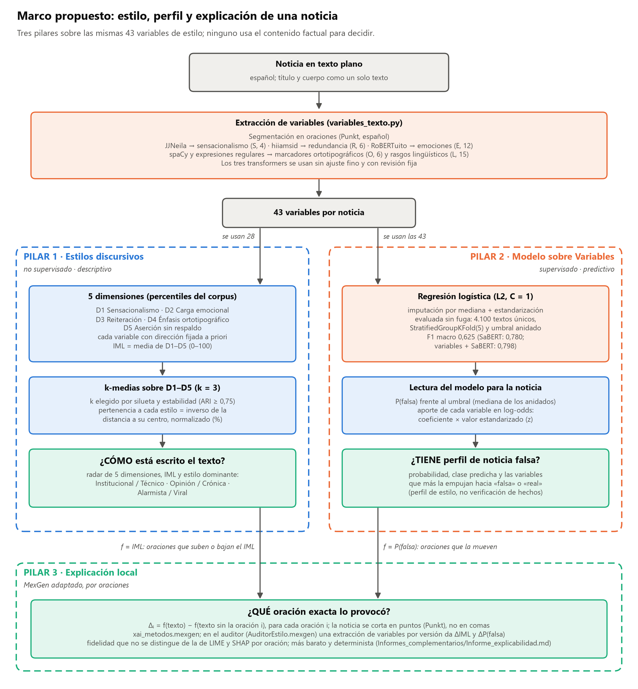

Resumen de la propuesta. Una noticia se convierte en 43 variables de estilo con tres transformers usados sin ajuste fino (JJNeila, hiiamsid y RoBERTuito), spaCy y expresiones regulares. Sobre esas variables trabajan tres pilares:
- **Estilos discursivos:** no supervisado. Responde **cómo** está escrito el texto: 5 dimensiones, el IML y el estilo dominante.
- **Modelo sobre Variables:** regresión logística supervisada. Responde si el texto **tiene perfil** de noticia falsa: P(falsa) y aporte de cada variable en log-odds.
- **MexGen por oraciones:** responde **qué oración** sostiene cada salida.

## 2. Fases del proyecto

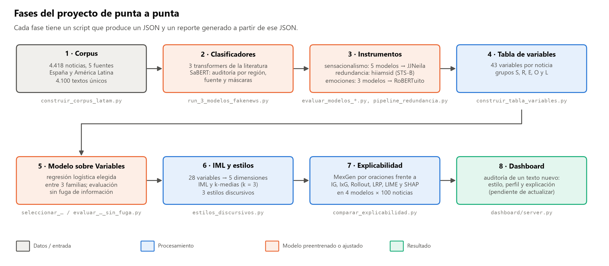

Las ocho fases en orden, con el script principal de cada una. Cada script deja un JSON y un reporte generado a partir de él.

## 3. Construcción del corpus

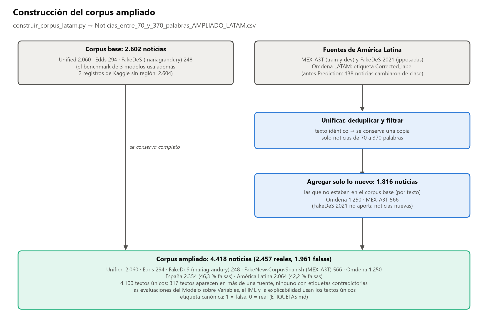

Al corpus base de 2.602 noticias (el benchmark de 3 modelos usa además 2 registros de Kaggle sin región, 2.604 en total) se le agregan las noticias de América Latina que no estaban (Omdena 1.250, MEX-A3T 566). En Omdena la etiqueta es `Corrected_label` y no `Prediction`. El resultado son 4.418 noticias y 4.100 textos únicos. Los análisis posteriores usan los textos únicos.

## 4. Instrumentos de estilo

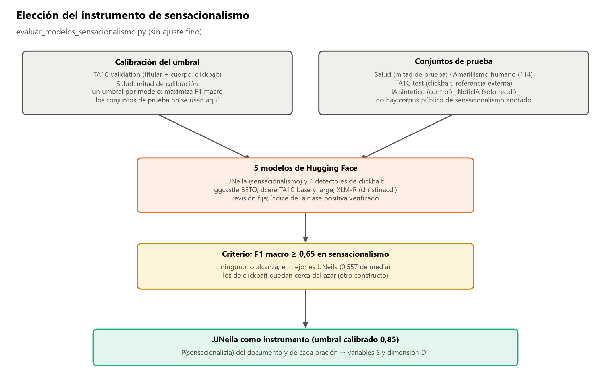

Se compararon 5 modelos con un umbral calibrado sin usar los conjuntos de prueba. Ninguno alcanza el criterio de F1 macro ≥ 0,65. JJNeila es el mejor en sensacionalismo y se usa como instrumento.

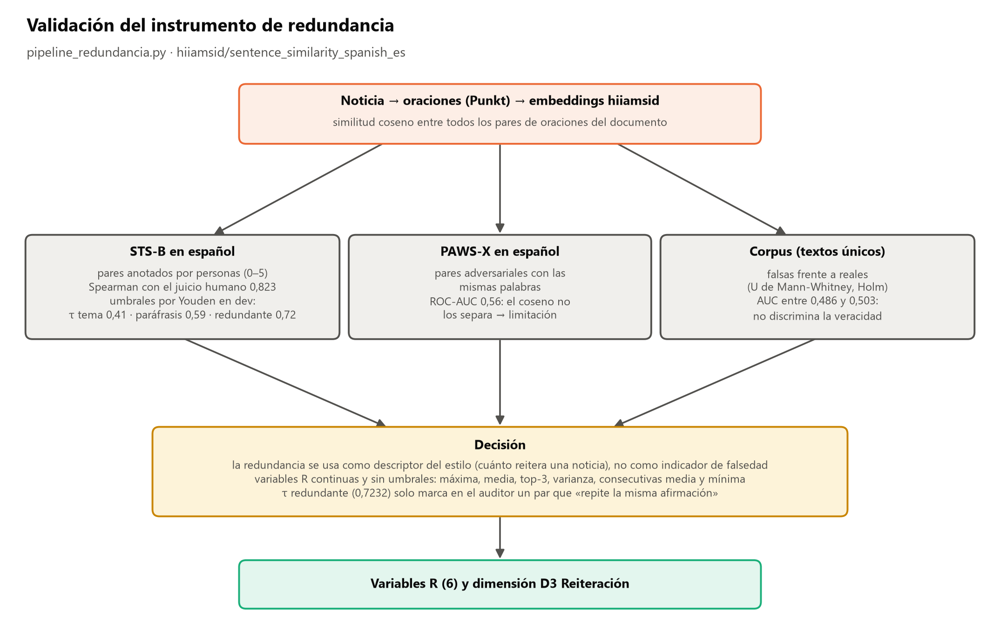

hiiamsid reproduce el juicio humano de similitud en STS-B, pero no separa las paráfrasis adversariales de PAWS-X ni discrimina la veracidad. Por eso la redundancia se usa como descriptor continuo del estilo, sin umbrales.

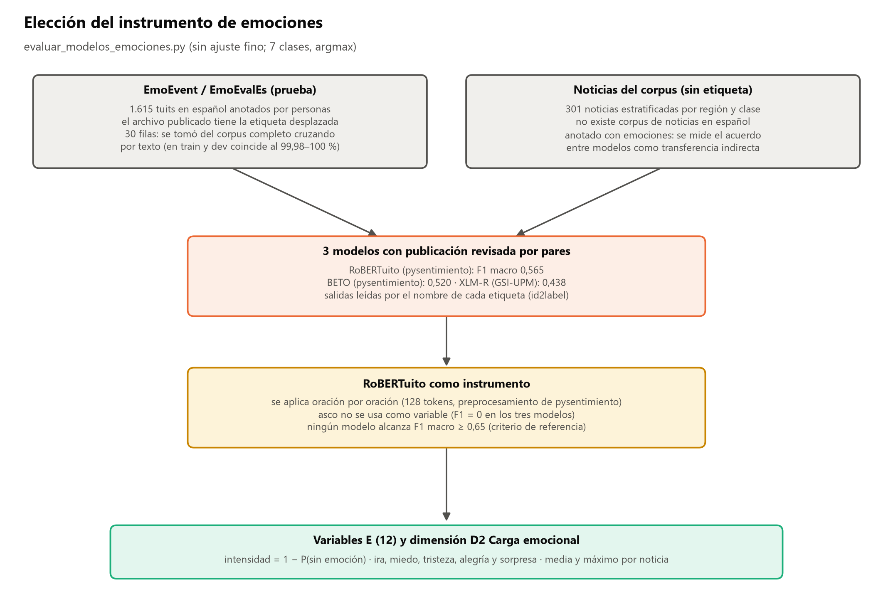

Se compararon 3 modelos sobre EmoEvent, tras corregir el desplazamiento de etiquetas del archivo de prueba. RoBERTuito es el mejor y se aplica oración por oración.

## 5. Variables y Modelo sobre Variables

Los cinco grupos de variables (S, R, E, O y L), con la herramienta que calcula cada uno. El mismo extractor sirve para la tabla del corpus y para un texto nuevo.

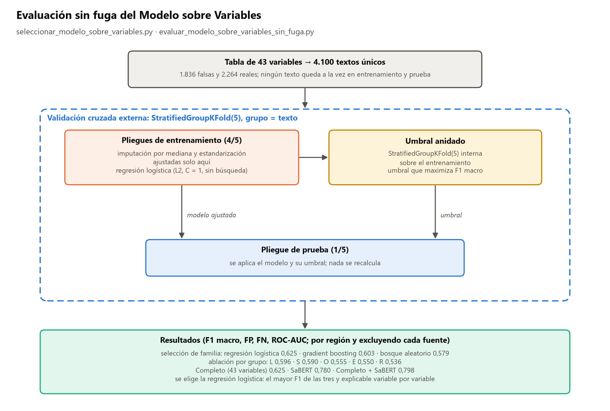

Validación cruzada agrupada por texto, con el preprocesamiento y el umbral aprendidos solo en el entrenamiento de cada pliegue. Incluye la selección entre tres familias de clasificadores y la ablación por grupo de variables.

## 6. IML y estilos discursivos

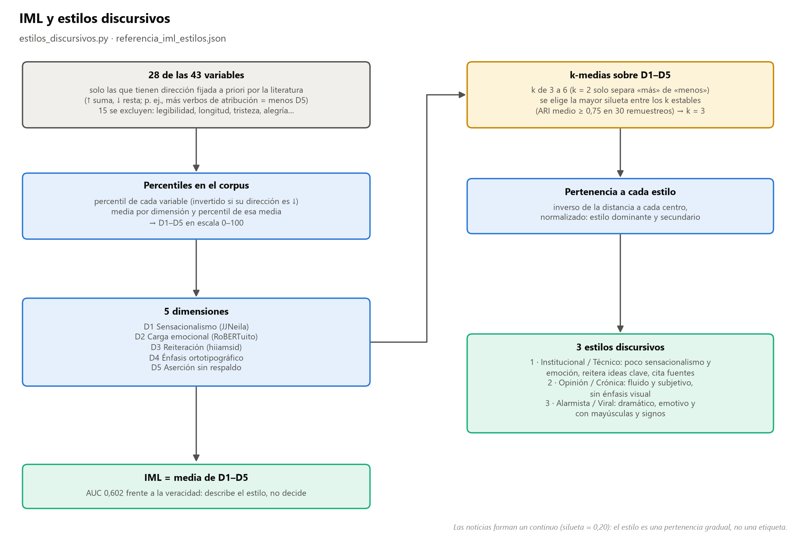

De 28 variables con dirección fijada a priori se obtienen 5 dimensiones en percentiles del corpus. El IML es su media. k-medias con k elegido por silueta y estabilidad da 3 estilos, y cada noticia recibe un grado de pertenencia a cada uno.

## 7. Explicabilidad

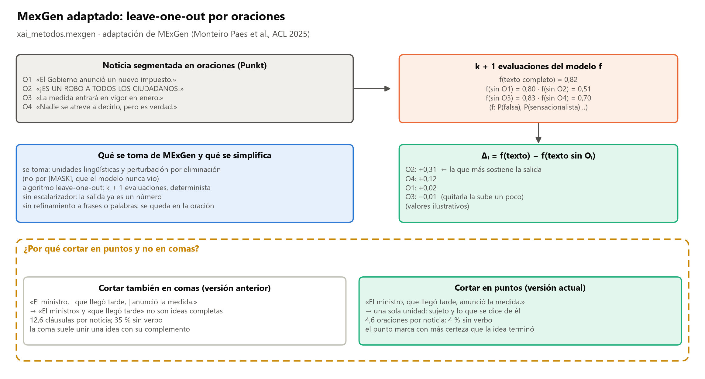

MexGen adaptado: quita una oración a la vez y mide cuánto cambia la salida del modelo. El diagrama explica qué se toma de MExGen, qué se simplifica y por qué se corta en puntos y no en comas. Los valores del ejemplo son ilustrativos.

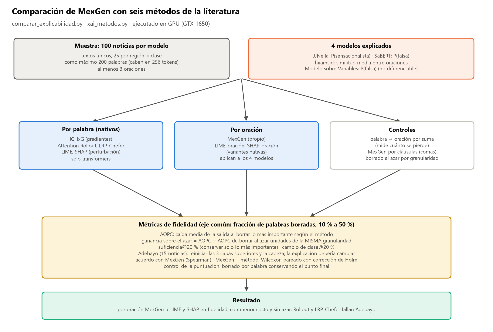

Protocolo de la comparación con seis métodos de la literatura: 4 modelos, 100 noticias por modelo, métodos por palabra y por oración, y métricas de fidelidad con control del azar de la misma granularidad.

## 8. Auditoría de un texto nuevo

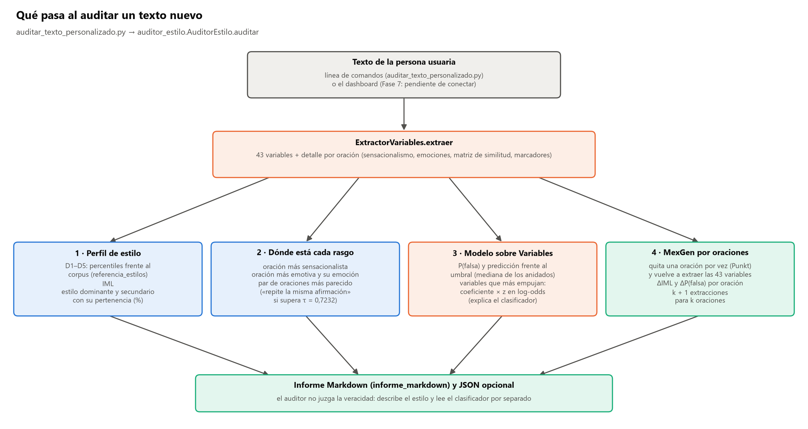

Lo que devuelve `auditar_texto_personalizado.py` para un texto: el perfil de estilo, las oraciones que concentran cada rasgo, la lectura del Modelo sobre Variables y MexGen por oraciones (qué oración sube el IML y cuál mueve P(falsa)).
