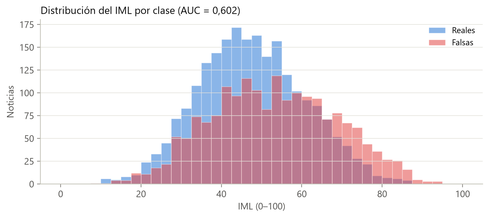
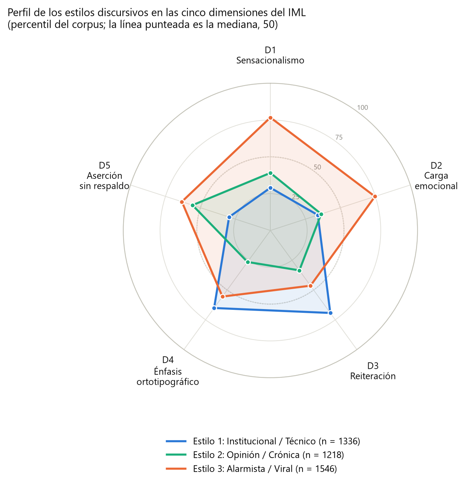
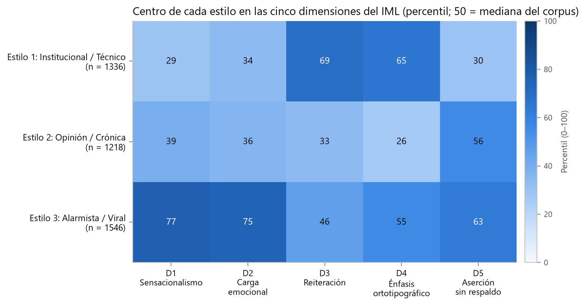
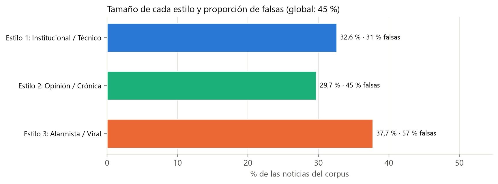
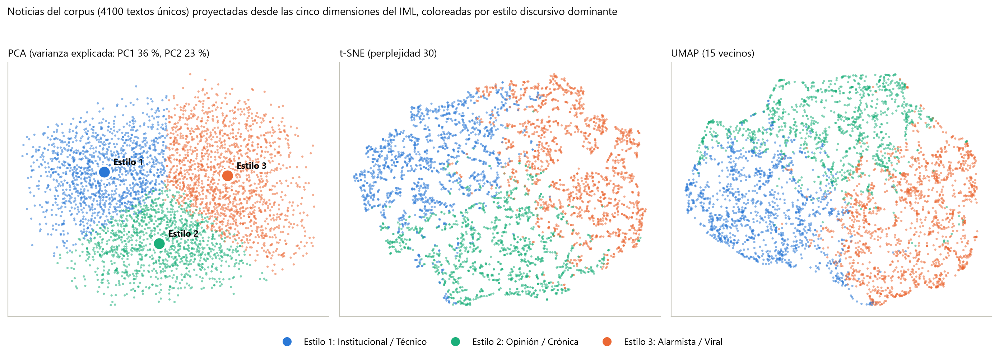
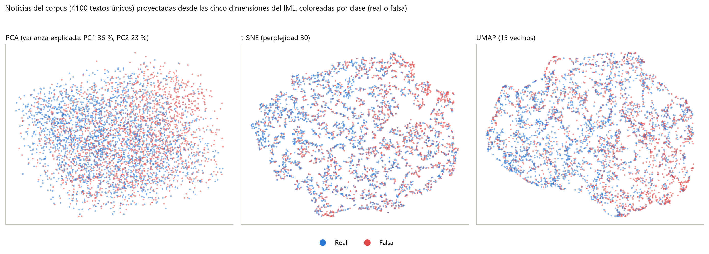

# Explicabilidad propia: IML, estilos discursivos y auditor

Componentes de **estilo** y de **explicación local** del marco propuesto. A partir de las 43 variables de cada noticia, esta carpeta construye el índice de manipulación lingüística (IML), los estilos discursivos y un auditor que, para cualquier texto, reúne el estilo, el perfil del clasificador interpretable y las oraciones que sostienen cada lectura. Ninguno de estos componentes verifica hechos: describen cómo está escrita una noticia.

| Elemento | Relación con la tesis |
|:---|:---|
| IML y dimensiones D1–D5 | Subsección 3.4.3, Tabla 3.5, Ecuaciones 3.5–3.7; resultados en la Subsección 4.2.3 y Tabla 4.6 |
| Estilos discursivos | Subsección 3.4.4, Ecuaciones 3.8–3.9; resultados en la Subsección 4.2.4, Tablas 4.7–4.8 y Figuras 4.10–4.13 |
| Explicación por oraciones (adaptación de MExGen) | Subsección 3.6.3, Tabla 3.7, Ecuación 3.14 |
| Auditor (integración de los componentes) | Subsección 3.6.4 |
| Casos de estudio | Subsección 4.4.6, Tabla 4.20 y Figuras 4.25–4.26 (versión final en [`Analisis_complementarios/`](../Analisis_complementarios/)) |

La comparación de la explicación por oraciones con seis métodos de la literatura (Sección 4.3) está en [`XAI_Literatura_Comparacion/`](XAI_Literatura_Comparacion/), documentada por separado. Las variables y el clasificador provienen de [`Modelo_sobre_Variables/`](../Modelos_Individuales/Clasificar_fake/Modelo_sobre_Variables/README.md).


## 1. Datos de entrada y salidas

| Script | Entrada | Salida |
|:---|:---|:---|
| `codigos/estilos_discursivos.py` | `Modelo_sobre_Variables/Dataset/tabla_variables_4418.csv` y su `_meta.json` | `reportes/iml_estilos_discursivos_4418.csv`, `reportes/metricas_iml_estilos_discursivos.json`, `codigos/referencia_iml_estilos.json`, `graficos/estilos/*.png` |
| `codigos/generar_reporte_estilos.py` | `reportes/metricas_iml_estilos_discursivos.json` | Reporte Markdown auxiliar en `reportes/` (no versionado; este README lo sustituye) |
| `codigos/variables_texto.py` | Un texto | Las 43 variables y el detalle por oración |
| `codigos/auditor_estilo.py` | Un texto + `referencia_iml_estilos.json` + tabla de variables + `metricas_modelo_sobre_variables_sin_fuga.json` + `Redundancia/Reportes/metricas_redundancia_hiiamsid.json` | Diccionario con perfil, variables, oraciones, clasificador y explicación por oraciones |
| `auditar_texto_personalizado.py` | Texto por línea de comandos o archivo `.txt` | Informe en pantalla y, opcionalmente, JSON y Markdown |
| `codigos/ejecutar_casos_estilo.py` | `codigos/casos_estudio_4_noticias.json` | Versión anterior de los casos (ver sección 6) |

`referencia_iml_estilos.json` guarda, para los 4.100 textos únicos, la distribución ordenada de cada variable y de cada dimensión, los centros de los estilos, sus nombres y lemas. Es lo que permite situar un texto nuevo respecto del corpus sin volver a leer la tabla.

## 2. Cómo ejecutar

Desde la raíz del repositorio:

```bash
python Explicabilidad_Propia/codigos/estilos_discursivos.py        # IML y estilos del corpus
python Explicabilidad_Propia/codigos/variables_texto.py            # opcional: verifica la extracción en 30 noticias del corpus
python Explicabilidad_Propia/auditar_texto_personalizado.py --texto "Texto de la noticia..."
python Analisis_complementarios/ejecutar_casos_originales.py       # los 4 casos de la tesis (versión final)
```

| Script | GPU | Internet | Observaciones |
|:---|:---|:---|:---|
| `estilos_discursivos.py` | No | No | Solo lee la tabla de variables: percentiles, k-medias con 30 remuestreos por cada k de 2 a 8, PCA, t-SNE y UMAP (requiere `umap-learn`). |
| `variables_texto.py`, auditor y casos | Opcional (`XAI_DISPOSITIVO=cpu` la desactiva) | Sí, la primera vez (JJNeila, `hiiamsid`, RoBERTuito, `es_core_news_sm`) | La explicación por oraciones extrae las variables K + 1 veces para un texto de K oraciones. En la ejecución registrada de los cuatro casos, cada auditoría tardó entre 2 y 11 s, sin contar la carga de los modelos. |

El IML, los estilos y sus figuras se reproducen sin GPU a partir de la tabla de variables incluida en el repositorio. Todas las operaciones aleatorias usan la semilla 42.

## 3. Métodos y decisiones

### 3.1 Índice de manipulación lingüística

Entran 28 de las 43 variables, aquellas con una dirección fijada *a priori* desde la literatura (↑: más valor, estilo más marcado; ↓: lo contrario).

| Dimensión | Variables (dirección) |
|:---|:---|
| D1 Sensacionalismo | `sens_p_documento`, `sens_p_media_oraciones`, `sens_p_max_oraciones` (↑) |
| D2 Carga emocional | `emo_intensidad`, `emo_ira`, `emo_miedo`, `emo_sorpresa`: media y máximo (↑) |
| D3 Reiteración | `red_sim_max`, `red_sim_media`, `red_sim_top3`, `red_consecutivas_media` (↑) |
| D4 Énfasis ortotipográfico | `orto_mayusculas_sostenidas`, `orto_proporcion_mayusculas`, `orto_exclamaciones`, `orto_interrogaciones`, `orto_puntos_suspensivos`, `orto_comillas` (↑) |
| D5 Aserción sin respaldo | `ling_intensificadores`, `ling_pronombres_1p`, `ling_adjetivos_sustantivos` (↑); `ling_atenuadores`, `ling_verbos_dicendi`, `ling_cifras`, `ling_referencias_temporales` (↓) |

| Variables excluidas | Motivo (fijado en `EXCLUIDAS`) |
|:---|:---|
| `sens_sd_oraciones`, `red_sim_varianza` | Dispersión, sin dirección |
| `red_consecutivas_min` | Una oración inconexa puede indicar tanto manipulación como estilo informativo |
| `emo_tristeza_*`, `emo_alegria_*` | Baja activación o valencia positiva |
| `ling_flesch_szigriszt`, `ling_guiraud`, `ling_hapax` | Complejidad o riqueza léxica, no manipulación |
| `ling_adverbios`, `ling_pronombres_3p` | Dirección no establecida en la literatura en español |
| `ling_porcentajes` | Redundante con `ling_cifras` |
| `ling_palabras`, `ling_oraciones` | Longitud |

El script comprueba que las variables usadas y excluidas cubren exactamente las 43. Cálculo:

1. Percentil orientado de cada variable respecto de los textos únicos (Ecuación 3.5; rango medio en los empates).
2. Dimensión = percentil, dentro del corpus, de la media de los percentiles de sus variables (Ecuación 3.6). El segundo paso evita que las dimensiones con muchas variables poco correlacionadas (D4, D5) queden comprimidas cerca de 50.
3. IML = media simple de las dimensiones disponibles (Ecuación 3.7); en los textos de una sola oración falta D3 y se promedian cuatro.

No se usan pesos ni constantes ajustadas, y la etiqueta de veracidad no interviene en la construcción: solo se usa después, para describir.

### 3.2 Estilos discursivos

| Decisión | Implementación | Motivo |
|:---|:---|:---|
| Espacio | k-medias sobre (D1, …, D5) de los textos únicos; D3 faltante = 50 | Las dimensiones ya están en una escala común. |
| Rango de k | 3 a 6 (2, 7 y 8 se calculan como referencia) | Con k = 2 solo se separa «más» de «menos» a lo largo de un eje; por encima de 6 los estilos dejan de ser abarcables. |
| Regla de elección (fijada antes) | Mayor silueta entre los k con ARI medio ≥ 0,75 en 30 remuestreos *bootstrap* | Un estilo que cambia al remuestrear no puede ofrecerse como descripción. |
| Pertenencia | Inverso de la distancia euclídea a cada centro, normalizado a 100 % (Ecuación 3.9) | Los estilos son zonas de un continuo; se informa el dominante, el secundario y el vector completo. |
| Nombres | Regla explícita en `asignar_nombres()`: Alarmista / Viral = mayor media de D1, D2 y D4; de los otros dos, Institucional / Técnico = menor D1 + D2 y debe tener menor D5; Opinión / Crónica = el restante y debe tener menor D3. Si un centro no cumple su condición, el script se detiene | El nombre se asigna por el perfil del centro, no por el número del grupo ni por la etiqueta. |
| Visualización | PCA, t-SNE (perplejidad 30) y UMAP (15 vecinos); vecindad medida en el espacio original de cinco dimensiones | Las proyecciones no lineales conservan vecindades, no distancias globales. |

### 3.3 Explicación por oraciones y auditor

La importancia de cada oración es Δᵢ = f(D) − f(D sin sᵢ) (Ecuación 3.14), con oraciones delimitadas por Punkt y retiradas completas, de modo que el texto restante sigue siendo gramatical. El auditor aplica la misma extracción de variables a cada versión del texto y la usa para dos salidas: el IML (y cada dimensión) y la probabilidad de la clase falsa del clasificador interpretable. El procedimiento es determinista y requiere K + 1 extracciones.

Para el componente de perfil, el auditor ajusta la regresión logística con los 4.100 textos únicos y usa como umbral la mediana de los umbrales anidados de la validación cruzada (0,47). Informa también los aportes β_j·z_j de las variables con mayor contribución. El par de oraciones más parecido se marca como «repite la misma afirmación» si supera el umbral calibrado en STS Benchmark (Tabla 4.5), único uso de umbrales de redundancia en el marco.

`variables_texto.py` reproduce la extracción del corpus para un texto nuevo; su función `verificar_contra_tabla()` compara los valores recalculados con los de la tabla en 30 noticias del corpus.

## 4. Perfilar un texto nuevo

```bash
# Texto en línea
python Explicabilidad_Propia/auditar_texto_personalizado.py --texto "Titular. Cuerpo de la noticia..."

# Desde un archivo, con salidas en JSON y Markdown
python Explicabilidad_Propia/auditar_texto_personalizado.py --archivo noticia.txt --titulo "Mi noticia" \
    --salida_json resultado.json --salida_md informe.md
```

| Argumento | Uso |
|:---|:---|
| `--texto` / `--archivo` | Texto de la noticia (titular y cuerpo), directo o desde un `.txt` en UTF-8 |
| `--titulo` | Título del informe (por defecto, «Noticia personalizada») |
| `--salida_json`, `--salida_md` | Guardan el resultado completo y el informe |

El informe contiene:

- **Estilo:** D1–D5, IML, estilo dominante y secundario con su pertenencia, y el percentil de cada variable dentro de su dimensión.
- **Dónde está cada rasgo:** la oración más sensacionalista, la más emotiva y su emoción, el par de oraciones más parecido y los marcadores encontrados (mayúsculas sostenidas, signos, intensificadores, atenuadores, verbos de atribución).
- **Perfil:** P(falsa), predicción con el umbral 0,47 y las variables que más empujan la decisión.
- **Explicación por oraciones:** ΔIML y ΔP(falsa) de cada oración y las oraciones extremas en cada sentido. No se aplica a textos de una sola oración.

Para usarlo desde Python:

```python
import sys; sys.path.insert(0, 'Explicabilidad_Propia/codigos')
from auditor_estilo import AuditorEstilo, informe_markdown
r = AuditorEstilo().auditar(texto, 'Título')       # con_mexgen=False omite la explicación por oraciones
print('\n'.join(informe_markdown(r)))
```

El marco se diseñó para noticias en español de 70 a 370 palabras con titular y cuerpo (Subsección 3.6.5). Los percentiles son relativos a este corpus: un IML de 70 significa «más marcado que el 70 % de estas noticias».

## 5. Resultados principales

### 5.1 IML y veracidad (Tabla 4.6)

| Indicador | AUC (falsa) | Media en falsas | Media en reales |
|:---|---:|---:|---:|
| D1 Sensacionalismo | 0,625 | 56,9 | 44,4 |
| D2 Carga emocional | 0,565 | 53,6 | 47,1 |
| D3 Reiteración | 0,449 | 47,2 | 52,3 |
| D4 Énfasis ortotipográfico | 0,520 | 51,1 | 49,1 |
| D5 Aserción sin respaldo | 0,616 | 56,4 | 44,8 |
| **IML** | **0,602** | 53,0 | 47,5 |

La asociación existe pero es débil, y la reiteración se comporta en sentido contrario al esperado. En 21 de las 28 variables la dirección observada coincide con la fijada *a priori*; las siete restantes (las cuatro de redundancia, `orto_proporcion_mayusculas`, `orto_comillas` y `ling_atenuadores`) tienen AUC entre 0,45 y 0,51 y se mantienen sin cambios, porque definen el constructo.



### 5.2 Número de estilos (Tabla 4.7)

| k | Silueta | ARI medio | ARI, percentil 5 |
|---:|---:|---:|---:|
| 2 | 0,227 | 0,948 | 0,910 |
| **3** | **0,197** | **0,773** | 0,401 |
| 4 | 0,183 | 0,753 | 0,451 |
| 5 | 0,189 | 0,746 | 0,562 |
| 6 | 0,191 | 0,767 | 0,602 |

Se eligen tres estilos: k = 3, 4 y 6 superan el ARI medio de 0,75 y k = 3 tiene la mayor silueta entre ellos. La estabilidad es **marginal**: el ARI medio supera 0,75 por poco y en el 5 % de los remuestreos menos favorables baja a 0,401. Las siluetas bajas (0,18–0,23) indican que no hay grupos naturales bien separados.


### 5.3 Perfil de los estilos (Tabla 4.8)

| Estilo | D1 | D2 | D3 | D4 | D5 | Noticias | % del corpus | % falsas |
|:---|---:|---:|---:|---:|---:|---:|---:|---:|
| Institucional / Técnico | 29 | 34 | 69 | 65 | 30 | 1.336 | 32,6 % | 30,6 % |
| Opinión / Crónica | 39 | 36 | 34 | 26 | 56 | 1.218 | 29,7 % | 44,7 % |
| Alarmista / Viral | 77 | 75 | 46 | 56 | 63 | 1.546 | 37,7 % | 57,1 % |







La proporción de falsas crece del estilo Institucional / Técnico al Alarmista / Viral (44,8 % en el corpus), pero el estilo no separa la veracidad. Los dos primeros componentes principales explican el 36 % y el 23 % de la varianza. Entre los 15 vecinos más cercanos de cada noticia, el 89 % comparte su estilo (34 % al azar), lo que se espera en buena medida por construcción, y solo el 54 % comparte su clase (51 % al azar).





## 6. Casos de estudio

La versión de la tesis de los cuatro casos (Tabla 4.20; Figuras 4.25 y 4.26) se genera con [`Analisis_complementarios/ejecutar_casos_originales.py`](../Analisis_complementarios/ejecutar_casos_originales.py). Ese script toma el texto exacto de cada noticia del corpus ampliado (índices 2357, 3071, 3653 y 2), ejecuta este auditor sin cambios, añade la probabilidad fuera de pliegue del protocolo original y reutiliza las funciones de figuras de `codigos/ejecutar_casos_estilo.py`. Los resultados quedan en `Analisis_complementarios/casos_estilo/`.

| Caso (clase en el corpus) | IML | Estilo dominante | P(falsa) [fuera de pliegue] | Oración más influyente: IML / P(falsa) |
|:---|---:|:---|---:|:---|
| 1. Bulo de salud con mayúsculas, FakeDeS (falsa) | 72,9 | Alarmista / Viral (43 %) | 0,77 [0,79] | O1: +26,5 / O1: +0,272 |
| 2. Fichaje inventado de un futbolista, MEX-A3T (falsa) | 39,6 | Opinión / Crónica (63 %) | 0,48 [0,49] | O1: +5,0 / O3: +0,076 |
| 3. Reclamo laboral de médicos de un hospital público, Omdena (real) | 35,1 | Institucional / Técnico (61 %) | 0,15 [0,16] | O2: +7,7 / O4: −0,052 |
| 4. Crónica científica de agencia, Edds (real) | 57,2 | Institucional / Técnico (54 %) | 0,28 [0,26] | O2: +10,7 / O3: −0,060 |


`codigos/ejecutar_casos_estilo.py` y `codigos/casos_estudio_4_noticias.json` corresponden a una versión anterior de los casos; se conservan porque `ejecutar_casos_originales.py` reutiliza el código del primero. Sus salidas anteriores se retiraron del repositorio para evitar confusiones con la versión final.

## 7. Limitaciones

1. El IML es un índice compuesto **descriptivo y exploratorio**: resume la intensidad de marcadores de estilo que la literatura asocia con la manipulación, pero no mide la intención de manipular ni está validado como medida de ese constructo, y no tiene interpretación causal.
2. Su asociación con la veracidad es débil (AUC 0,602), y siete de las 28 direcciones fijadas *a priori* no coinciden con lo observado en este corpus.
3. Los percentiles son relativos al corpus de referencia (España y América Latina, 70 a 370 palabras).
4. Los estilos tienen silueta baja y estabilidad marginal con k = 3; son zonas de un continuo útiles para describir, no tipos discretos. Sus nombres interpretan el perfil del centro, no el género periodístico real, que no fue anotado.
5. Las variables de sensacionalismo y emociones heredan las limitaciones de sus instrumentos, que no alcanzaron el criterio de aceptación (Subsección 4.2.1).
6. La explicación por oraciones describe de qué partes del texto depende la salida, no si esa salida es correcta; al retirar una oración pueden perderse referencias (por ejemplo, pronombres).
7. Los cuatro casos ilustran el funcionamiento del marco y no constituyen evidencia de su desempeño general; además forman parte del corpus con que se ajustó el clasificador, por lo que su probabilidad se informa también fuera de pliegue.

## 8. Archivos

| Ruta | Contenido |
|:---|:---|
| `auditar_texto_personalizado.py` | Línea de comandos del auditor |
| `codigos/estilos_discursivos.py` | IML, estilos, proyecciones y figuras; funciones `perfilar()` y `dibujar_radar()` |
| `codigos/variables_texto.py` | Extracción de las 43 variables para un texto nuevo y su verificación |
| `codigos/auditor_estilo.py` | Clase `AuditorEstilo` e `informe_markdown()` |
| `codigos/generar_reporte_estilos.py` | Reporte auxiliar de construcción a partir del JSON |
| `codigos/ejecutar_casos_estilo.py`, `codigos/casos_estudio_4_noticias.json` | Versión anterior de los casos (código reutilizado por la versión final) |
| `codigos/referencia_iml_estilos.json` | Distribuciones de referencia, centros, nombres y lemas de los estilos |
| `reportes/iml_estilos_discursivos_4418.csv` | D1–D5, IML, estilo, pertenencias, región, fuente y etiqueta de las 4.418 noticias |
| `reportes/metricas_iml_estilos_discursivos.json` | Elección de k, centros, asociación con la veracidad, direcciones empíricas, correlaciones y proyecciones |
| `graficos/estilos/` | Figuras del IML y de los estilos |
