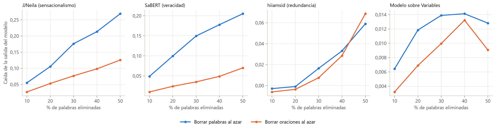
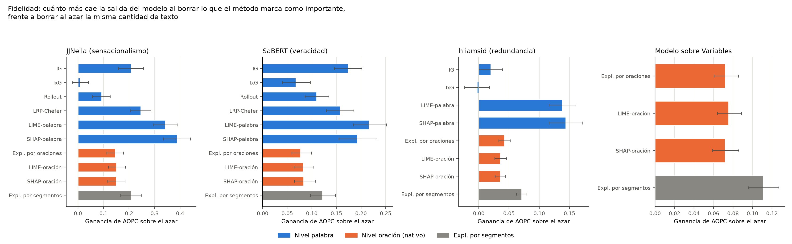
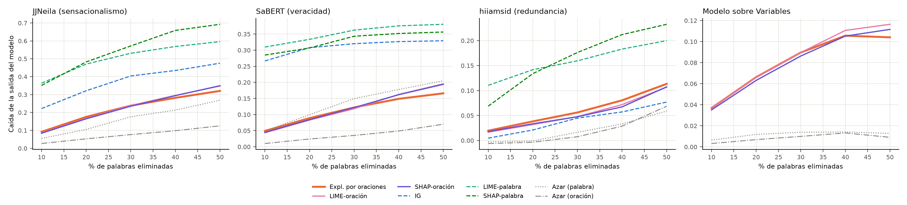
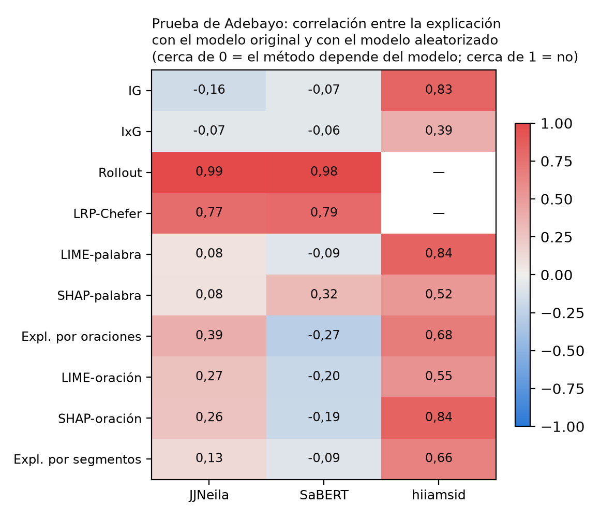
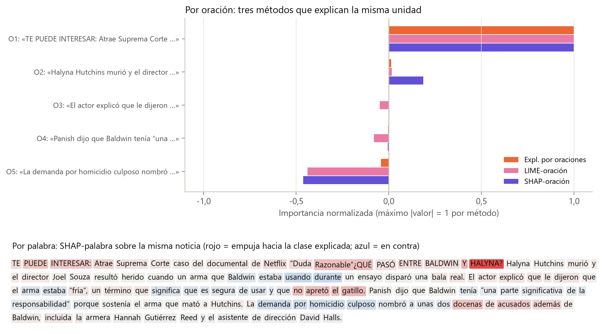
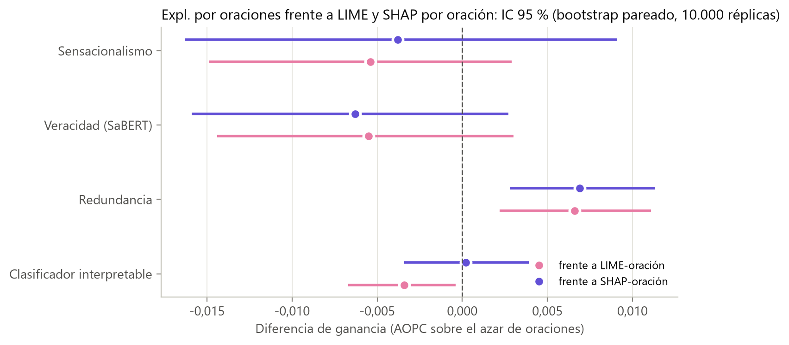
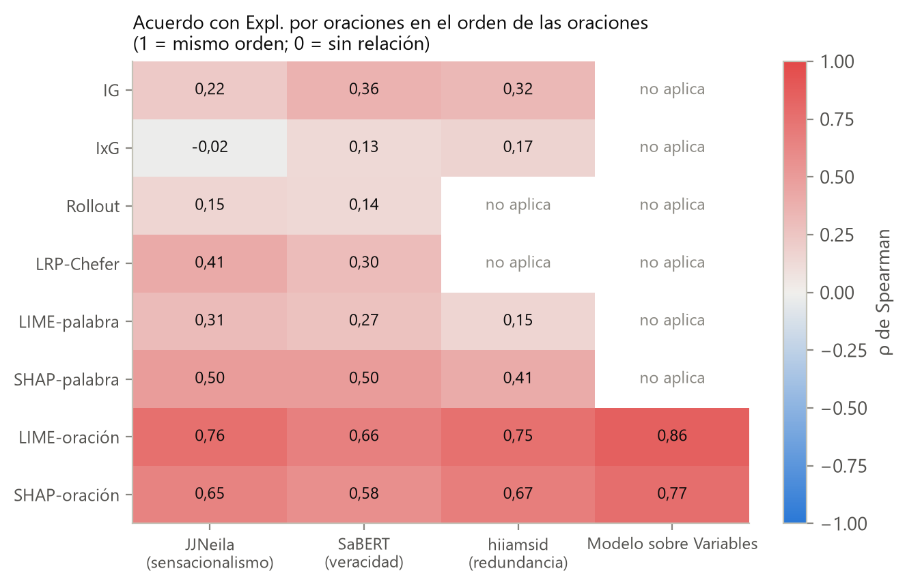
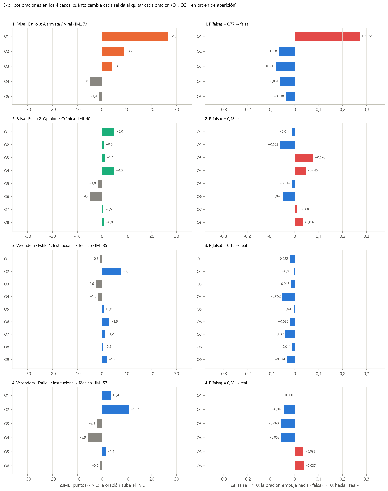

# Informe complementario: la explicabilidad en el trabajo

*Natali Alba Tobías y Daniel Santiago Camacho Gutiérrez*

Este informe amplía lo que en la tesis ocupa la Sección 3.5 (métodos de la literatura y cómo los evaluamos), la Subsección 3.6.3 (explicación por oraciones), la Sección 4.3 (fidelidad y confiabilidad) y la Subsección 4.4.5 (comparación en la misma unidad). En el documento escrito tuvimos que resumir. Aquí contamos con más detalle qué hicimos, por qué tomamos cada decisión y de qué archivo del repositorio sale cada cifra y cada figura, para que quien lea la tesis pueda seguir cualquier resultado hasta el código.

En el código y en los JSON, la explicación por oraciones conserva el nombre interno `MexGen`. Es una adaptación de MExGen (Monteiro Paes et al., 2025) con *leave-one-out* por oraciones. La variante que corta también en comas se llama `MexGen-cláusulas`. En la tesis son la «Expl. por oraciones» y la «Expl. por segmentos».

---

## 1. Qué entendemos por explicar

Una explicación local responde a una pregunta: **¿de qué partes de este texto depende la salida del modelo?** No responde si la salida es correcta ni si la noticia es verdadera. Esa distinción recorre todo el trabajo y es la razón de que midamos la fidelidad y no la «verdad» de las explicaciones.

En el trabajo hay tres granularidades posibles:

| Unidad | Métodos | Ventaja | Problema |
|:---|:---|:---|:---|
| Palabra (subpalabra) | Gradientes integrados, gradiente por entrada, Attention Rollout, LRP-Chefer, LIME y SHAP por palabra | Es la resolución nativa de los Transformers | Borrar palabras sueltas produce textos agramaticales, y una lista de palabras es difícil de leer para una persona |
| Oración | Explicación por oraciones, LIME-oración y SHAP-oración | Cada unidad tiene sentido completo y se puede contrastar | Pierde detalle dentro de la oración |
| Variable | Coeficientes del clasificador interpretable (β·z) | Dice *qué rasgo* de estilo pesa | No dice *dónde* está ese rasgo en el texto |

El marco propuesto combina la segunda y la tercera: el clasificador dice qué rasgos pesan y la explicación por oraciones dice en qué oración están.

*Figura generada por `Diagramas/generar_diagramas.py` (función del diagrama `comparacion_xai`).*

## 2. Los cuatro modelos que explicamos

| Modelo | Qué se explica | Clase en `xai_metodos.py` |
|:---|:---|:---|
| Sensacionalismo (JJNeila, `1b8140e`) | P de la clase predicha | `Clasificador` |
| Veracidad (SaBERT, `c092c97`) | P de la clase predicha | `Clasificador` |
| Redundancia (`hiiamsid`, `66ab46a`) | Similitud media entre oraciones | `Redundancia` |
| Clasificador interpretable (43 variables) | P de la clase predicha | `ModeloVariables` |

Explicamos la **probabilidad de la clase predicha**, no la de la clase «falsa». Así, borrar lo importante siempre hace bajar la salida y las curvas de borrado de todas las noticias se pueden promediar.

El clasificador interpretable no es diferenciable respecto del texto: entre el texto y la probabilidad hay tres modelos de lenguaje, spaCy y reglas. Por eso solo admite métodos de perturbación por oración (Tabla 3.6). En redundancia no hay cabeza de clasificación, así que no se aplican los métodos basados en atención.

**Muestra (`comparar_explicabilidad.py`).** Tomamos 100 textos únicos por modelo, 25 por estrato región × clase, con semilla 42. Cada texto tiene al menos 3 oraciones y como máximo 200 palabras. El límite de 200 palabras garantiza que todos los métodos vean el texto completo dentro de las 256 subpalabras. La contrapartida es que la muestra no cubre las noticias más largas del corpus: en el corpus ampliado, el 34,0 % supera las 256 subpalabras (Subsección 4.5.5).

## 3. Los métodos y dónde están en el código

Todos están en `Explicabilidad_Propia/XAI_Literatura_Comparacion/codigos/xai_metodos.py`.

| Método | Granularidad | Parámetros | Notas de implementación |
|:---|:---|:---|:---|
| Gradientes integrados | palabra | `N_PASOS_IG = 32`, referencia `[PAD]` | Integral de Riemann sobre las *embeddings* (Ec. A.4) |
| Gradiente por entrada | palabra | — | Producto del gradiente por la *embedding* (Ec. A.3) |
| Attention Rollout | palabra | — | Producto de las matrices de atención con la identidad (Ec. A.5) |
| LRP-Chefer | palabra | — | Relevancia del gradiente por la atención, acumulada por capa |
| LIME | palabra / oración | `N_LIME_PALABRA = 200`, `N_LIME_ORACION = 50` (40 en el clasificador interpretable) | Biblioteca `lime`; la unidad se **borra**, no se enmascara |
| SHAP de partición | palabra / oración | 300 evaluaciones por palabra; por oración, `max(2K+1, min(2^K, 64))` | Biblioteca `shap` con máscara por unidades |
| Explicación por oraciones | oración | — | Δᵢ = f(D) − f(D sin sᵢ) (Ec. 3.14); determinista, K + 1 evaluaciones |

En el clasificador interpretable bajamos LIME-oración a 40 perturbaciones porque cada evaluación vuelve a extraer las 43 variables con tres modelos de lenguaje. La Tabla A.2 de la tesis dice «50 por oración» sin esa excepción.

## 4. Cómo medimos la fidelidad

### 4.1 Curva de borrado y AOPC

Para cada noticia ordenamos las unidades de mayor a menor importancia según el método. Luego las retiramos hasta eliminar una fracción q de las palabras, con q ∈ {0,1; 0,2; 0,3; 0,4; 0,5}, y registramos la caída de la salida. El AOPC es la caída media en esos cinco puntos. Si el método acierta con lo importante, la salida cae rápido y el AOPC es alto.

### 4.2 Por qué restamos el azar *de la misma granularidad*

Borrar palabras sueltas daña el texto aunque se borren al azar. La Tabla 4.11 lo muestra con la misma fracción de palabras eliminadas:

| Modelo | AOPC palabras al azar | AOPC oraciones al azar | Razón |
|:---|---:|---:|---:|
| Sensacionalismo | 0,164 | 0,076 | 2,2 |
| Veracidad | 0,136 | 0,038 | 3,6 |
| Redundancia | 0,021 | 0,019 | 1,1 |
| Clasificador interpretable | 0,012 | 0,008 | 1,4 |

Si comparáramos AOPC brutos, los métodos por palabra ganarían por el solo hecho de romper el texto. Por eso la métrica principal es la **ganancia**: el AOPC del método menos la media de tres órdenes aleatorios de *sus mismas unidades*. Una ganancia de 0 significa «no mejor que borrar al azar». El cálculo está en `xai_metodos.py` (funciones de borrado) y la consolidación por noticia en `comparar_explicabilidad.py`.

### 4.3 Otras medidas

- **Suficiencia:** caída de la salida al conservar solo el 20 % más importante. Menor es mejor.
- **Cambio de clase:** porcentaje de noticias que cambian de clase al borrar el 20 % más importante.
- **Control de puntuación** (`complementar()`): repite la curva de los métodos por palabra conservando la puntuación de cierre de las palabras borradas, para separar la fidelidad real del efecto de fusionar oraciones.

### 4.4 Confiabilidad: prueba de Adebayo

Un método confiable debe cambiar su explicación cuando el modelo pierde lo aprendido. Reiniciamos la cabeza y las tres capas superiores (solo las capas en redundancia) y medimos la correlación de Spearman entre la explicación original y la del modelo dañado. Una correlación alta es mala señal: el método describe el texto, no la decisión. Usamos 15 noticias por modelo (`N_ADEBAYO = 15` en `comparar_explicabilidad.py`). No se aplica al clasificador interpretable.

### 4.5 Inferencia

- Las medias llevan IC del 95 % por *bootstrap* (2.000 réplicas, en `generar_reporte_comparacion_xai.py`).
- La explicación por oraciones se compara con cada método mediante Wilcoxon pareado y corrección de Holm dentro de cada modelo.
- Por petición del tutor añadimos un *bootstrap* pareado de 10.000 réplicas sobre las diferencias por noticia (sección 6).

## 5. Resultados, figura por figura

### 5.1 Ganancia por método (Tabla 4.9, Figura 4.14)

| Método | Sensacionalismo | Veracidad | Redundancia | Clasif. interpretable |
|:---|---:|---:|---:|---:|
| Gradientes integrados | 0,208 | 0,174 | 0,020 | — |
| Gradiente por entrada | 0,008 | 0,067 | −0,003 | — |
| Attention Rollout | 0,092 | 0,110 | — | — |
| LRP-Chefer | 0,245 | 0,158 | — | — |
| LIME (palabra) | 0,342 | 0,216 | 0,138 | — |
| SHAP (palabra) | 0,388 | 0,192 | 0,144 | — |
| LIME-oración | 0,151 | 0,083 | 0,036 | 0,075 |
| SHAP-oración | 0,150 | 0,084 | 0,036 | 0,072 |
| Expl. por oraciones | 0,146 | 0,077 | 0,043 | 0,072 |

Por palabra, los métodos de perturbación (LIME y SHAP) son los más fieles. Los gradientes simples quedan cerca del azar. Por oración, los tres métodos quedan prácticamente empatados dentro de cada modelo. Las ganancias por palabra y por oración **no se comparan entre sí**, porque cada una se mide frente a su propio azar.

*Fuente:* `reportes/datos/metricas_comparacion_xai.json`. La figura se genera con `generar_reporte_comparacion_xai.py` y se renombra con `Analisis_complementarios/figuras_oe3_renombradas.py`.

### 5.2 Curvas de borrado (Figura 4.15)

En los dos clasificadores, LIME y SHAP por palabra producen con el 10 % de las palabras una caída mayor que la de los métodos por oración con el 50 %. Las tres curvas por oración casi se superponen. En el clasificador interpretable todas las caídas son pequeñas (por debajo de 0,12): cada variable resume el documento entero, y retirar una oración la mueve poco.

### 5.3 Lo que se pierde al sumar palabras por oración (Tabla 4.10)

Una alternativa obvia a nuestra explicación sería sumar por oración las atribuciones de palabra. La comparamos:

| Agregado por oración | Sensacionalismo | Veracidad | Redundancia |
|:---|---:|---:|---:|
| Gradientes integrados | 0,004 | 0,045 | 0,009 |
| Gradiente por entrada | −0,007 | 0,016 | 0,001 |
| Attention Rollout | −0,005 | −0,007 | — |
| LRP-Chefer | 0,070 | 0,045 | — |
| LIME (palabra) | 0,068 | 0,037 | 0,024 |
| SHAP (palabra) | 0,122 | 0,073 | 0,026 |
| **Expl. por oraciones** | **0,146** | **0,077** | **0,043** |

Los gradientes integrados bajan de 0,208 a 0,004. La razón es que las atribuciones por palabra tienen signos mezclados y, al sumarlas, se cancelan. La explicación por oraciones supera a la versión agregada en las 16 comparaciones (Wilcoxon-Holm, p < 0,05). Si se quiere una explicación por oraciones, hay que perturbar oraciones, no sumar palabras.

### 5.4 Control de puntuación (Tabla 4.12)

En redundancia, buena parte de la fidelidad aparente de LIME y SHAP por palabra venía de borrar puntos finales, lo que fusiona oraciones y cambia la segmentación. Al conservar la puntuación de cierre, LIME baja de 0,138 a 0,058 y SHAP de 0,144 a 0,097. Entre el 11 % y el 34 % de las palabras del 10 % superior eran signos de cierre, frente a un 4 % en el texto. En los clasificadores, Attention Rollout y LRP-Chefer también concentran signos de puntuación.

### 5.5 Confiabilidad (Figura 4.16)

- Attention Rollout (ρ = 0,99 y 0,98) y LRP-Chefer (0,77 y 0,79) casi no cambian al aleatorizar el modelo: describen sobre todo la estructura del texto.
- Los gradientes, LIME y SHAP sí cambian.

Con 15 noticias los intervalos son amplios: para la explicación por oraciones en sensacionalismo el IC es [0,06; 0,65]. Los intervalos están en `Analisis_complementarios/adebayo_ic.json` y se obtienen con `Analisis_complementarios/adebayo_ic.py`. La prueba indica la dirección, no la magnitud precisa.

### 5.6 Un ejemplo visual (Figura 4.18)

La misma noticia explicada por palabra y por oración. La versión por palabra resalta términos dispersos y signos de puntuación. La versión por oración señala una unidad que se puede leer y contrastar.

## 6. Explicación por oraciones frente a LIME y SHAP en la misma unidad (Tabla 4.18)

Este es el resultado que más discutimos con nuestro tutor, y vale la pena precisar cómo debe leerse.

| Modelo | Expl. por oraciones | LIME-oración (dif.; p Holm) | SHAP-oración (dif.; p Holm) |
|:---|---:|---:|---:|
| Sensacionalismo | 0,146 | 0,151 (−0,005; 0,372) | 0,150 (−0,004; 0,372) |
| Veracidad | 0,077 | 0,083 (−0,005; 0,624) | 0,084 (−0,006; 0,764) |
| Redundancia | 0,043 | 0,036 (+0,007; 0,004) | 0,036 (+0,007; 0,019) |
| Clasificador interpretable | 0,072 | 0,075 (−0,003; 0,130) | 0,072 (0,000; 0,991) |

El *bootstrap* pareado (10.000 réplicas; `Analisis_complementarios/calculos_revision_tutor.py`) da los intervalos de la diferencia:

*Figura nueva de este informe, generada con `Informes_complementarios/figuras_informes.py` a partir de `Analisis_complementarios/revision_tutor/tarea3_bootstrap_pareado.csv`.*

**Cómo lo leemos:**

1. **Lo que no decimos.** No decimos que la explicación por oraciones sea «más fiel». No encontrar diferencia no prueba equivalencia, y por eso en la versión final escribimos «su fidelidad no se distingue de la de LIME y SHAP».
2. **Siete de los ocho intervalos coinciden con Wilcoxon-Holm.** En sensacionalismo y veracidad incluyen el 0. En redundancia quedan por encima del 0, a favor de la explicación por oraciones.
3. **La excepción es el clasificador interpretable frente a LIME-oración.** Su intervalo, [−0,0067; −0,0004], queda apenas debajo del 0, mientras que Wilcoxon da p = 0,130. Que los dos procedimientos discrepen refleja lo pequeña que es la diferencia (−0,003).
4. **Por qué los tres métodos convergen.**
   - Hay una media de 4,6 oraciones por noticia. Con K = 5 oraciones solo existen 2⁵ = 32 subconjuntos.
   - SHAP-oración usa `max(2K+1, min(2^K, 64))` evaluaciones, es decir, las 32: con K ≤ 6 recorre todas las coaliciones.
   - LIME-oración usa 50 muestras, más que los subconjuntos posibles.
   - El *leave-one-out* es la aproximación de primer orden de esas mismas cantidades.

   A esta escala, los tres son casi el mismo estimador. La comparación muestra que el *leave-one-out* es una aproximación adecuada cuando las unidades son pocas.
5. **Ventajas prácticas de la explicación por oraciones.**
   - Es determinista: da el mismo resultado en cada ejecución, sin semilla.
   - Cuesta K + 1 evaluaciones.
   - Su lectura es directa: cuánto cambia la salida si esta oración no estuviera.

El orden de las oraciones coincide en buena medida con el de LIME y SHAP (ρ de Spearman entre 0,58 y 0,86; Figura 4.19).

## 7. Comprensibilidad: oraciones frente a segmentos (Tabla 4.19)

También probamos a cortar en comas (`MexGen-cláusulas`):

| | Unidades por noticia | Unidades con verbo | Ganancia media |
|:---|---:|---:|:---|
| Oraciones | 4,6 | 96 % | referencia |
| Segmentos (comas) | 12,6 | 65 % | +0,044 sobre la de oraciones |

Los segmentos son algo más fieles, pero un tercio no tiene verbo y no se puede leer como afirmación. Para apoyar a una persona que revisa una noticia elegimos la oración. Como criterio funcional de comprensibilidad, la unidad debe poder leerse y contrastarse sola.

## 8. La explicación por oraciones dentro del marco

`Explicabilidad_Propia/codigos/auditor_estilo.py` aplica el *leave-one-out* a **dos** salidas a la vez:

- el IML y cada una de sus dimensiones;
- la probabilidad de la clase falsa del clasificador interpretable.

Así, para cada oración se informa ΔIML y ΔP(falsa). En el primer caso de estudio, la misma oración (un titular en mayúsculas) es la que más eleva las dos salidas (+26,5 en el IML y +0,272 en la probabilidad).

*Generada por `Analisis_complementarios/ejecutar_casos_originales.py`. Los textos completos con ΔIML / ΔP por oración están en el Apéndice A.4 de la tesis.*

## 9. Cadena de reproducción

| Elemento de la tesis | Script | Datos |
|:---|:---|:---|
| Tablas 4.9 a 4.12, Figuras 4.14 a 4.19 | `XAI_Literatura_Comparacion/codigos/generar_reporte_comparacion_xai.py` y `Analisis_complementarios/figuras_oe3_renombradas.py` | `reportes/datos/metricas_comparacion_xai.json` (construido desde `codigos/cache/`) |
| Tabla 4.18 (Wilcoxon-Holm) | `generar_reporte_comparacion_xai.py` | mismo JSON |
| IC bootstrap de la Tabla 4.18 | `Analisis_complementarios/calculos_revision_tutor.py` | mismo JSON → `revision_tutor/tarea3_bootstrap_pareado.csv` |
| IC de Adebayo | `Analisis_complementarios/adebayo_ic.py` | `codigos/cache/*/adebayo_*.json` → `adebayo_ic.json` |
| Tabla 4.20, Figuras 4.25–4.26 | `Analisis_complementarios/ejecutar_casos_originales.py` | tabla de variables + auditor |
| Figura de los IC (este informe) | `Informes_complementarios/figuras_informes.py` | `tarea3_bootstrap_pareado.csv` |

Con la caché incluida, todo lo anterior se reproduce sin GPU en segundos o pocos minutos. Recalcular las atribuciones desde cero exige los cuatro modelos y varias horas: el cálculo original usó una GTX 1650 de 4 GB.

## 10. Limitaciones

1. Las métricas de borrado sacan al modelo de su distribución. Restar el azar de la misma granularidad lo atenúa, pero no lo elimina.
2. La fidelidad dice de qué depende la salida, no si la salida es correcta.
3. La muestra (100 noticias por modelo, de 200 palabras o menos y al menos 3 oraciones) no cubre las noticias largas.
4. LIME y SHAP por palabra usaron un presupuesto limitado de perturbaciones (200 y 300). Con más, su fidelidad podría variar.
5. La prueba de Adebayo es parcial (un único reinicio de capas superiores, sin cascada) y usa 15 noticias.
6. Al retirar una oración pueden perderse referencias, por ejemplo pronombres que remiten a ella. La explicación por oraciones no modela esa dependencia.
