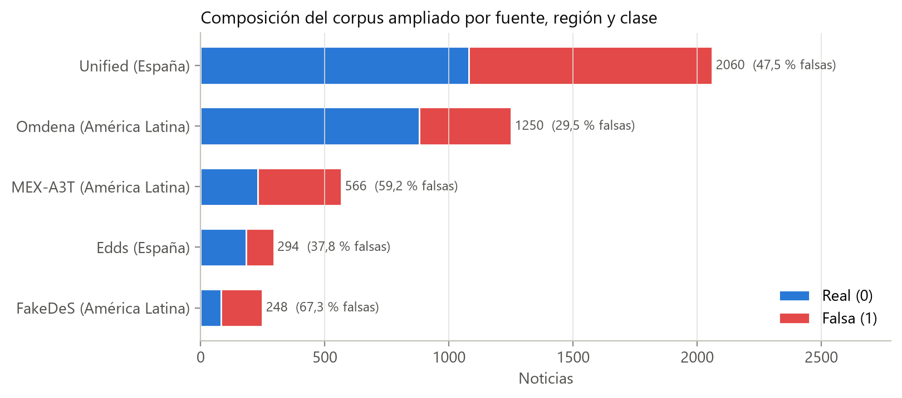
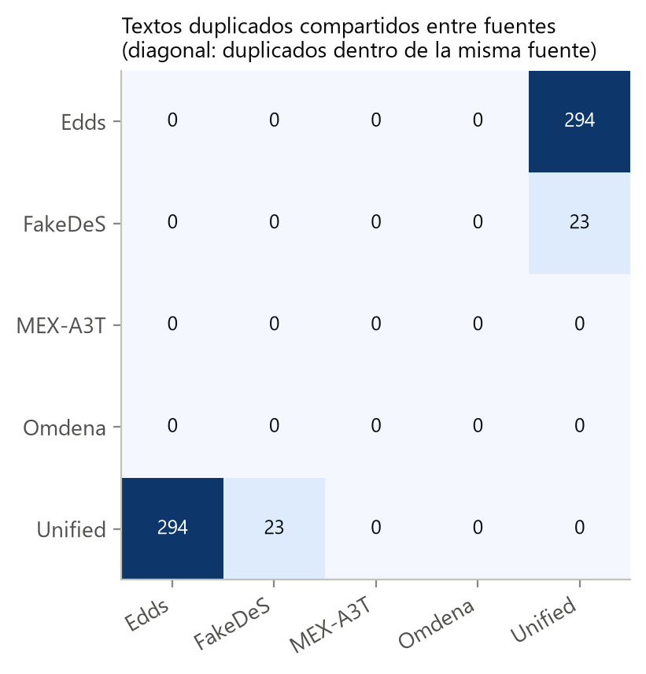
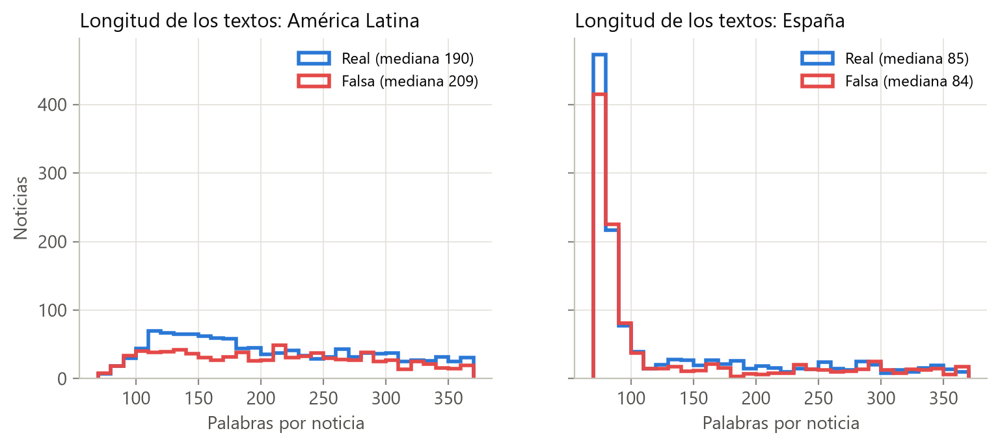

# Corpus base y corpus ampliado España – América Latina

Esta carpeta contiene los datos de partida de toda la investigación: el **corpus base** de 2.604 noticias con que se comparan los clasificadores de la literatura y el **corpus ampliado** de 4.418 noticias de España y América Latina sobre el que se evalúan SaBERT, las variables lingüísticas, el clasificador interpretable y la explicabilidad.

## 1. Relación con la tesis

| Elemento de la tesis | Qué respalda esta carpeta |
|:---|:---|
| Sección 3.2.1 (Corpus base) | Archivo `Noticias_entre_70_y_370_palabras (1).xlsx` (2.604 noticias) |
| Sección 3.2.2 y Tabla 3.2 (Composición del corpus ampliado) | `Noticias_entre_70_y_370_palabras_AMPLIADO_LATAM.csv` (4.418 noticias) y `construir_corpus_latam.py` |
| Sección 3.2.3 (Armonización y deduplicación) | Filtro de 70–370 palabras, normalización mínima, convención de etiquetas y conteo de duplicados |
| Sección 3.2.4 (Particiones de evaluación) | Columnas `region`, `dataset_origen` y `Fuente`, que definen las particiones por región y por fuente |
| Apéndice A.3 (Construcción del corpus) | Qué pasos se reproducen con programas y cuáles se conservan como archivo de datos |


## 2. Fuentes

| Fuente (nombre en la tesis) | Procedencia | Región | Etiqueta de origen | Corpus |
|:---|:---|:---|:---|:---|
| Unified (Freiren) | <https://huggingface.co/datasets/Freiren/Unified-and-Balanced-Spanish-Fake-News-Corpus> | España | `class` (True = real) | Base |
| Edds | <https://huggingface.co/datasets/Edds/spanish-fake-news-fixed> | España | `class` (True = real) | Base |
| FakeDeS | <https://huggingface.co/datasets/mariagrandury/fake_news_corpus_spanish> (FakeDeS, IberLEF 2021) | América Latina | `CATEGORY` | Base |
| Kaggle (2 registros) | <https://www.kaggle.com/datasets/arseniitretiakov/noticias-falsas-en-espaol> | Sin región | `class` | Solo base (2.604) |
| MEX-A3T | <https://github.com/jpposadas/FakeNewsCorpusSpanish> (`train.xlsx` y `development.xlsx`; Posadas-Durán et al., 2019) | América Latina | `Category` (True / Fake) | Ampliado |
| Omdena | <https://huggingface.co/datasets/IsaacRodgz/Fake-news-latam-omdena> (solo `Type == "Web Article"`) | América Latina | `Corrected_label` | Ampliado |

**Licencias.** Los textos pertenecen a sus repositorios de origen y se redistribuyen aquí solo con fines de investigación; las condiciones de uso son las que declara la ficha de cada repositorio, que deben consultarse antes de reutilizar los datos.

**Cautelas de procedencia (Sección 3.2.1).** Según su ficha, Unified combina cuatro colecciones, y la mayor (cerca del 93 % de sus registros) se construyó por extracción web y se amplió con modelos generativos (Blanco-Fernández et al., 2024): una parte de sus textos puede ser sintética y no se conoce la colección de origen de cada noticia. En Omdena la etiqueta se toma de la columna corregida por los curadores (`Corrected_label`) y no de `Prediction`, que es la salida de un clasificador automático; dentro del filtro de longitud, 138 de las 1.250 noticias cambian de clase entre ambas columnas (trazabilidad en `omdena_etiquetas_prediction_vs_corrected.csv`). MEX-A3T reemplaza cifras, enlaces y teléfonos por `*NUMBER*`, `*URL*` y `*PHONE*`.

## 3. Archivos de datos y convención de etiquetas

En todo el repositorio la noticia **falsa es la clase positiva (1)** y la real es 0 (`config_proyecto.etiqueta_binaria`, que rechaza cualquier valor no reconocido en lugar de asignar una clase por defecto).

| Archivo | Filas | Contenido |
|:---|---:|:---|
| `Noticias_entre_70_y_370_palabras (1).xlsx` | 2.604 | Corpus base original: `class` (booleano, True = real), `Text`, `Fuente` (URL), `conteo_palabras_text`, `label_num` (1 = falsa), `label_name`, `categoria`. Lo usan el benchmark de la Sección 3.3 y la calibración de redundancia. |
| `Noticias_entre_70_y_370_palabras (1).csv` | 2.602 | Corpus base con el esquema armonizado, sin los 2 registros de Kaggle. |
| `Noticias_entre_70_y_370_palabras_AMPLIADO_LATAM.csv` | 4.418 | Corpus ampliado (archivo canónico; `config_proyecto.CORPUS_AMPLIADO_CSV`). |
| `Noticias_entre_70_y_370_palabras_AMPLIADO_LATAM.xlsx` | 4.418 | Copia en Excel del anterior. |
| `predicciones_sabert_ampliado_4418.csv` | 4.418 | Corpus ampliado más `prob_fake` = P(falsa) de SaBERT, `prob_real` y `pred_sabert`. Es la caché de inferencia que usan `SABERT_Evaluacion/` y `Modelo_sobre_Variables/`. |
| `omdena_etiquetas_prediction_vs_corrected.csv` | 1.592 | Artículos web de Omdena con `Prediction`, `Prediction_prob`, `Annotation_action` y `Corrected_label` (trazabilidad de la etiqueta). |

Esquema armonizado del corpus ampliado (8 columnas):

| Columna | Descripción |
|:---|:---|
| `Text` | Texto de la noticia (titular y cuerpo), sin modificar salvo el recorte de espacios en los extremos en MEX-A3T y Omdena |
| `conteo_palabras_text` | Número de palabras separando por espacios (70–370) |
| `clase_num` | **1 = falsa, 0 = real** |
| `categoria` | `FALSA` / `VERDADERA` |
| `region` | `España` / `América Latina` |
| `Fuente` | URL del repositorio de origen |
| `subfuente_medio` | Medio, cuando el repositorio lo informa |
| `dataset_origen` | Corpus de origen (Unified, Edds, FakeDeS, MEX-A3T, Omdena) |

## 4. Cómo ejecutar

Desde la raíz del repositorio:

```bash
# 1. Ampliación latinoamericana (requiere internet; CPU; sin GPU)
python Modelos_Individuales/Clasificar_fake/Dataset/construir_corpus_latam.py
# 2. Figuras descriptivas del corpus (sin internet ni GPU; segundos)
python Modelos_Individuales/Clasificar_fake/Dataset/generar_reporte_corpus.py
```

- **Paso 1** descarga MEX-A3T desde GitHub y Omdena desde Hugging Face (biblioteca `datasets`). Tal como se indica en el Apéndice A.3, la unión de los repositorios del corpus base, la asignación de la región y la armonización final de columnas no tienen un programa que las reproduzca automáticamente: el resultado de esos pasos es el archivo canónico de esta carpeta. La salida directa del script conserva columnas de trabajo (`class`, `label_num`, `pais`, `tema`) e incluye los 2 registros de Kaggle; **sobrescribe** `..._AMPLIADO_LATAM.csv/.xlsx`, por lo que conviene ejecutarlo sobre una copia del repositorio si solo se quiere verificar la ampliación.
- **Paso 2** lee el corpus canónico y regenera las tres figuras de `Imagenes/` (además de un resumen auxiliar en Markdown).
- Ningún análisis posterior necesita repetir el paso 1: todos parten de los CSV publicados.

## 5. Qué hace cada script y por qué

### `construir_corpus_latam.py`

1. **Carga de MEX-A3T** (particiones de entrenamiento y desarrollo de `FakeNewsCorpusSpanish`) y de **Omdena** (particiones `train` y `test`, solo los registros de tipo artículo web). También lee `test.xlsx` (FakeDeS), pero ningún registro de esa partición se incorpora al corpus final, porque FakeDeS ya está representado en el corpus base.
2. **Codificación de la etiqueta** con una función que acepta solo `true`, `fake` o `false` y lanza un error ante cualquier otro valor, para que una codificación inesperada no se convierta silenciosamente en una clase.
3. **Normalización mínima.** Solo se eliminan los espacios en los extremos. No se tocan la puntuación, las mayúsculas, la ortografía ni las tildes, porque son rasgos que después se miden como variables de estilo.
4. **Deduplicación exacta** entre las fuentes nuevas (texto en minúsculas y sin espacios en los extremos) y **filtro de longitud** de 70 a 370 palabras, el mismo del corpus base, para que las fuentes nuevas cumplan el mismo criterio de inclusión.
5. **Ampliación sin redundancia:** solo se añaden las noticias latinoamericanas cuyo texto normalizado no esté ya en el corpus base. Resultado: 1.816 noticias nuevas (566 de MEX-A3T y 1.250 de Omdena), que sumadas a las 2.602 noticias con región del corpus base dan 4.418.

### `generar_reporte_corpus.py`

Calcula la composición por fuente, región y clase; la presencia de máscaras; los textos duplicados (texto en minúsculas con los espacios unificados) y la longitud por región y clase, y dibuja las figuras de la Sección 6.

## 6. Resultados principales

**Composición (Tabla 3.2 de la tesis).**

| Fuente | Región | Noticias | Reales (0) | Falsas (1) | % falsas | Con máscaras |
|:---|:---|---:|---:|---:|---:|---:|
| Unified | España | 2.060 | 1.081 | 979 | 47,5 % | 0 % |
| Edds | España | 294 | 183 | 111 | 37,8 % | 0 % |
| FakeDeS | América Latina | 248 | 81 | 167 | 67,3 % | 0,4 % |
| MEX-A3T | América Latina | 566 | 231 | 335 | 59,2 % | 67,8 % |
| Omdena | América Latina | 1.250 | 881 | 369 | 29,5 % | 0 % |
| **España** | | 2.354 | 1.264 | 1.090 | 46,3 % | |
| **América Latina** | | 2.064 | 1.193 | 871 | 42,2 % | |
| **Total** | | **4.418** | **2.457** | **1.961** | 44,4 % | |

El corpus base de la Sección 4.1.1 tiene 2.604 noticias (1.345 reales y 1.259 falsas): Unified, Edds y FakeDeS más los 2 registros falsos de Kaggle.



**Duplicados (Sección 3.2.3).** 317 textos aparecen más de una vez (635 registros; uno de ellos tres veces), siempre en fuentes distintas y sin etiquetas contradictorias: los 294 textos de Edds están contenidos en Unified, y otros 23 de FakeDeS también. Al conservar la primera aparición se eliminan 318 registros y quedan **4.100 textos únicos** (Unified 1.765, Edds 294, FakeDeS 225, MEX-A3T 566, Omdena 1.250; 2.264 reales y 1.836 falsos), que son la unidad de análisis de todo procedimiento con entrenamiento o selección de parámetros. El archivo canónico conserva los duplicados; la deduplicación la aplica cada análisis que la requiere. Entre los textos únicos hay además 448 pares casi idénticos (similitud coseno TF-IDF ≥ 0,90), 440 de ellos con etiqueta opuesta y casi todos dentro de Unified; su efecto se trata en el análisis de sensibilidad de la Sección 4.4.2.



**Longitud.** En América Latina los textos tienen 208 palabras de media (mediana 198); en España, 131 (mediana 85), de modo que la longitud también varía con la fuente.



## 7. Limitaciones

- **Región confundida con la fuente.** Cada fuente pertenece a una sola región: comparar España con América Latina equivale a comparar Unified y Edds con FakeDeS, MEX-A3T y Omdena. Las diferencias regionales no pueden atribuirse a la variedad geográfica del español.
- **Heterogeneidad de las fuentes.** Difieren en temas, épocas, proporción de falsas (del 29,5 % al 67,3 %), longitud, formato (máscaras de MEX-A3T) y criterio de anotación; un clasificador puede aprender la fuente en lugar de la veracidad.
- **Texto posiblemente sintético** en Unified y **pares casi idénticos** con etiqueta opuesta.
- **Etiquetas de Omdena** procedentes de una corrección del propio proyecto.
- Las etiquetas indican la veracidad asignada por cada corpus, no la intención de engañar.
- Pasos manuales en la reunión del corpus base y en la asignación de región (Apéndice A.3).

## 8. Archivos generados

- `construir_corpus_latam.py` → `Corpus_LatAm_entre_70_y_370_palabras.(csv|xlsx)`, `Corpus_LatAm_Completo_sin_filtrar.(csv|xlsx)` (intermedios, no incluidos en el repositorio) y `Noticias_entre_70_y_370_palabras_AMPLIADO_LATAM.(csv|xlsx)`.
- `generar_reporte_corpus.py` → `Imagenes/composicion_fuente_region_clase.png`, `Imagenes/duplicados_entre_fuentes.png`, `Imagenes/longitud_por_region_clase.png` y `Reporte_Corpus_Ampliado.md` (resumen auxiliar generado automáticamente).
