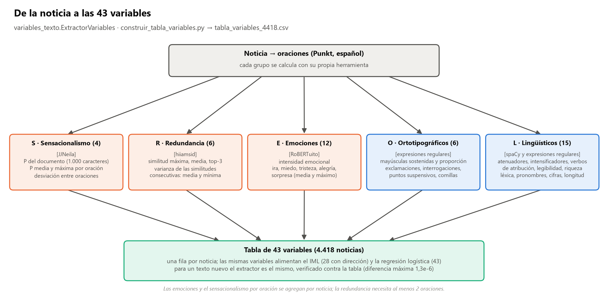
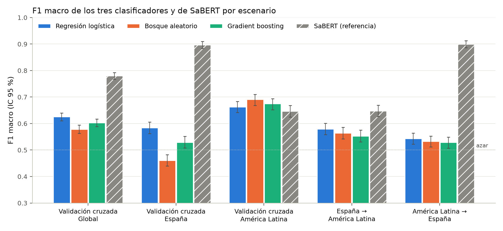
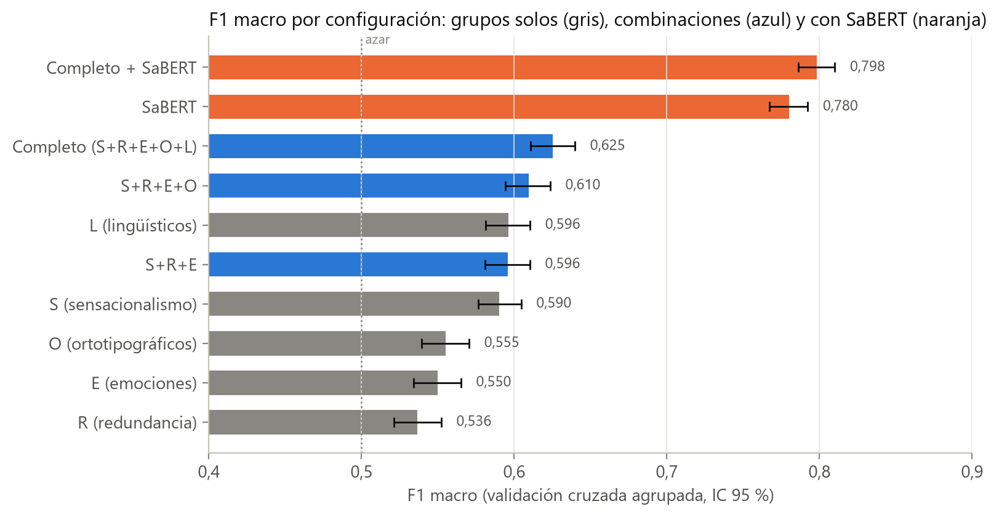
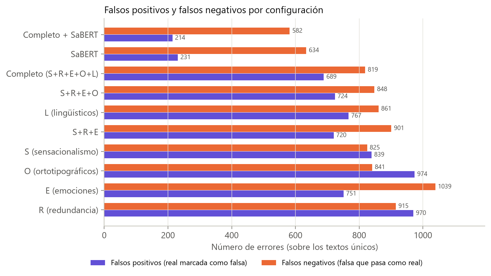
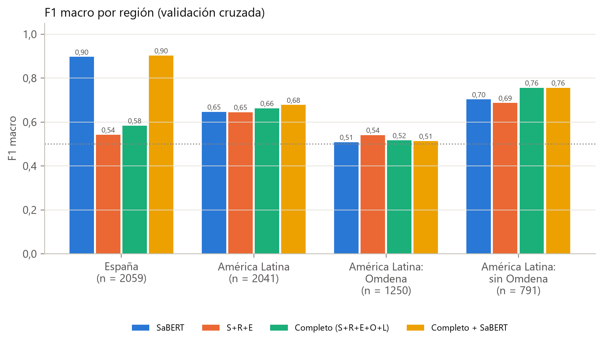
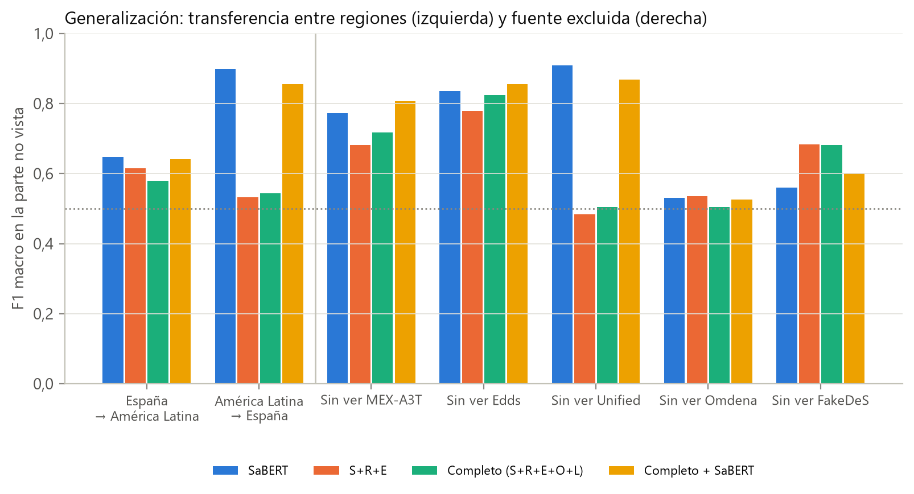
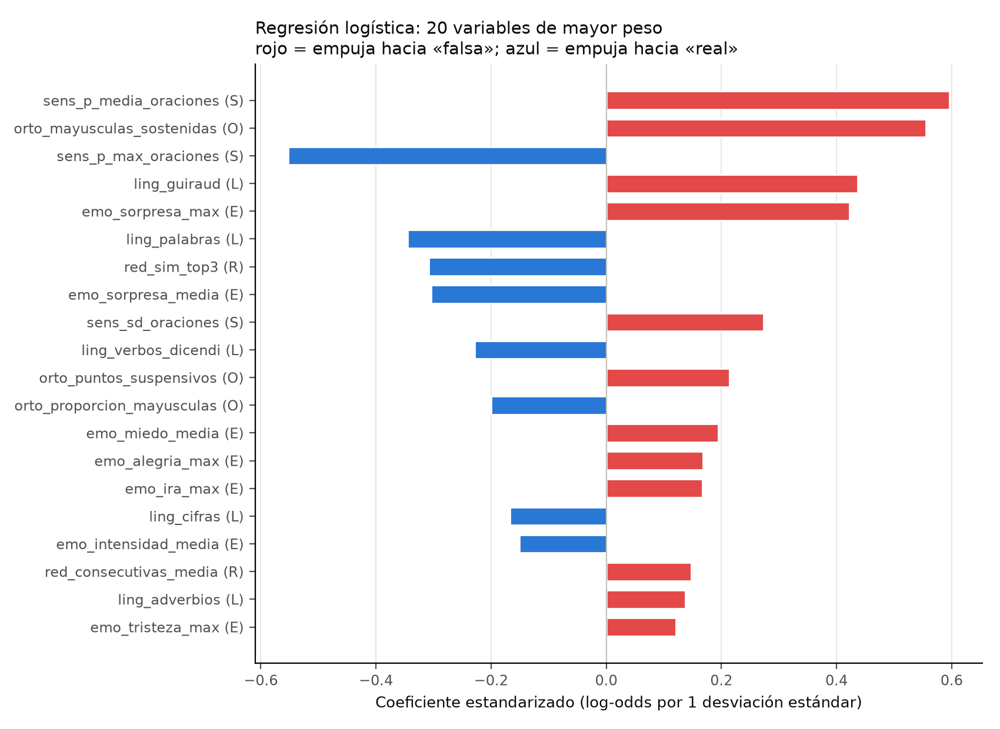

# Modelo sobre Variables (clasificador interpretable)

Componente de **perfil** del marco propuesto: un clasificador que no lee el texto directamente, sino las 43 variables lingüísticas de cada noticia, y estima la probabilidad de que sea falsa. Esta carpeta contiene la construcción de la tabla de variables, la selección del clasificador entre tres familias y su evaluación sin fuga de información frente a SaBERT.

| Elemento | Relación con la tesis |
|:---|:---|
| 43 variables en cinco familias (S, R, E, O, L) | Subsección 3.4.2, Tabla 3.4, Ecuaciones 3.1–3.4; diccionario en el Apéndice A.2 |
| Selección del clasificador | Subsección 3.6.1; resultados en la Subsección 4.4.1, Tabla 4.13 y Figura 4.20 |
| Regresión logística | Ecuación 3.13 |
| Protocolo sin fuga | Subsección 3.6.2 |
| Desempeño y aporte de cada familia | Subsección 4.4.2, Tabla 4.14 y Figura 4.21 |
| Regiones, transferencia y exclusión de fuentes | Subsección 4.4.3, Tablas 4.16–4.17 y Figuras 4.22–4.23 |
| Coeficientes | Subsección 4.4.4 y Figura 4.24 |

La misma tabla de variables alimenta el índice de manipulación lingüística (IML), los estilos discursivos y el auditor de [`Explicabilidad_Propia/`](../../../Explicabilidad_Propia/README.md).



## 1. Datos de entrada y salidas intermedias

| Paso | Script (`Codigos/`) | Entrada | Salida |
|:---|:---|:---|:---|
| 0a | `extraer_features_modelo_sobre_variables_ampliado.py` | `Clasificar_fake/Dataset/Noticias_entre_70_y_370_palabras_AMPLIADO_LATAM.csv` (4.418 noticias) | `Codigos/features_modelo_sobre_variables_ampliado_4418.csv` (S y R de origen) |
| 0b | `extraer_features_avanzadas_5d.py` | CSV del paso 0a | `Codigos/features_modelo_sobre_variables_ampliado_avanzado_4418.csv` (añade O y L) |
| 1 | `construir_tabla_variables.py` | corpus ampliado + CSV del paso 0b + `cache/emociones_oraciones_robertuito.npy` | `Dataset/tabla_variables_4418.csv`, `Dataset/tabla_variables_4418_meta.json` |
| 2 | `seleccionar_modelo_sobre_variables.py` | tabla + `Clasificar_fake/Dataset/predicciones_sabert_ampliado_4418.csv` | `Reportes/metricas_seleccion_modelo_sobre_variables.json`, `Reportes/Imagenes/seleccion_modelo/*.png` |
| 3 | `evaluar_modelo_sobre_variables_sin_fuga.py` | tabla + predicciones de SaBERT + JSON del paso 2 (modelo elegido) | `Reportes/metricas_modelo_sobre_variables_sin_fuga.json`, `Reportes/predicciones_modelo_sobre_variables_sin_fuga.csv` |
| 4 | `generar_reporte_modelo_sobre_variables_sin_fuga.py` | JSON del paso 3 | `Reportes/Imagenes/sin_fuga/*.png` |

`generar_reporte_seleccion_modelo.py` y `generar_reporte_modelo_sobre_variables_sin_fuga.py` escriben además un reporte Markdown auxiliar en `Reportes/` a partir de los JSON; este README los sustituye y no se versionan.

Los CSV de los pasos 0a y 0b contienen columnas exploratorias (umbrales semánticos, discretizaciones) que no forman parte de la tesis: solo se usan las columnas que `construir_tabla_variables.py` asigna a las 43 variables.

## 2. Cómo ejecutar

Desde la raíz del repositorio:

```bash
# Pasos 0a y 0b: solo si se desea repetir la extracción de origen (requiere los modelos de lenguaje)
python Modelos_Individuales/Clasificar_fake/Modelo_sobre_Variables/Codigos/extraer_features_modelo_sobre_variables_ampliado.py
python Modelos_Individuales/Clasificar_fake/Modelo_sobre_Variables/Codigos/extraer_features_avanzadas_5d.py

# Pasos 1 a 4
python Modelos_Individuales/Clasificar_fake/Modelo_sobre_Variables/Codigos/construir_tabla_variables.py
python Modelos_Individuales/Clasificar_fake/Modelo_sobre_Variables/Codigos/seleccionar_modelo_sobre_variables.py
python Modelos_Individuales/Clasificar_fake/Modelo_sobre_Variables/Codigos/evaluar_modelo_sobre_variables_sin_fuga.py
python Modelos_Individuales/Clasificar_fake/Modelo_sobre_Variables/Codigos/generar_reporte_modelo_sobre_variables_sin_fuga.py
```

| Paso | GPU | Internet | Observaciones |
|:---|:---|:---|:---|
| 0a, 0b | Recomendable (se usa si está disponible) | Sí, la primera vez (descarga de JJNeila, `hiiamsid` y `es_core_news_sm`) | Inferencia sobre las 4.418 noticias y sus oraciones. |
| 1 | No | Sí, la primera vez | Con la caché de emociones presente, RoBERTuito no se ejecuta; solo se recalculan S y R en 40 noticias para verificar los valores reutilizados (CPU). |
| 2 | No | No | 193 s en la ejecución registrada (tres familias, umbral anidado). |
| 3 | No | No | 59 s en la ejecución registrada. |
| 4 | No | No | Solo figuras. |

**Reproducción sin GPU.** Con los CSV de origen y `cache/emociones_oraciones_robertuito.npy` (probabilidades de RoBERTuito para las 26.428 oraciones del corpus) incluidos en el repositorio, los pasos 1 a 4 se reproducen en CPU. Todas las particiones y modelos usan la semilla 42 (`config_proyecto.SEED`).

## 3. Las 43 variables

Todas se calculan sobre oraciones segmentadas con Punkt de NLTK para español, descartando los segmentos de ocho caracteres o menos (Subsección 3.4.2). Los nombres son los de `Dataset/tabla_variables_4418.csv`.

| Familia | N.º | Variables | Instrumento |
|:---|---:|:---|:---|
| **S** · Sensacionalismo | 4 | `sens_p_documento`, `sens_p_media_oraciones`, `sens_p_max_oraciones`, `sens_sd_oraciones` | JJNeila (documento: primeros 1.000 caracteres, 256 subpalabras; oración: 128 subpalabras) |
| **R** · Redundancia | 6 | `red_sim_max`, `red_sim_media`, `red_sim_top3`, `red_sim_varianza`, `red_consecutivas_media`, `red_consecutivas_min` | `hiiamsid` (coseno entre oraciones, continuo, sin umbrales) |
| **E** · Emociones | 12 | `emo_intensidad_*`, `emo_ira_*`, `emo_miedo_*`, `emo_tristeza_*`, `emo_alegria_*`, `emo_sorpresa_*` (media y máximo) | RoBERTuito (128 subpalabras; intensidad = 1 − P(sin emoción)) |
| **O** · Ortotipografía | 6 | `orto_mayusculas_sostenidas`, `orto_proporcion_mayusculas`, `orto_exclamaciones`, `orto_interrogaciones`, `orto_puntos_suspensivos`, `orto_comillas` | Expresiones regulares, sin máscaras de anonimización |
| **L** · Rasgos lingüísticos | 15 | `ling_atenuadores`, `ling_intensificadores`, `ling_verbos_dicendi`, `ling_flesch_szigriszt`, `ling_guiraud`, `ling_hapax`, `ling_adjetivos_sustantivos`, `ling_pronombres_1p`, `ling_pronombres_3p`, `ling_adverbios`, `ling_cifras`, `ling_porcentajes`, `ling_referencias_temporales`, `ling_palabras`, `ling_oraciones` | Listas léxicas, expresiones regulares y spaCy |

## 4. Decisiones metodológicas

| Decisión | Implementación | Motivo |
|:---|:---|:---|
| Reutilizar S, R, O y L de la extracción de origen | `construir_tabla_variables.py` recalcula S y R en 40 noticias con la revisión fija de cada modelo y aborta si la diferencia supera 10⁻³ | Evitar repetir la inferencia; la diferencia máxima observada fue 1,7·10⁻⁶ (`sens_p_documento`). |
| Emociones por oración | Probabilidades leídas por nombre de clase; media y máximo por noticia | El orden de índices difiere entre modelos; el asco entra solo en la intensidad (Subsección 3.4.2). |
| Valores faltantes | En las 133 noticias de una sola oración, las cuatro variables de similitud entre pares quedan como NaN y se imputan con la mediana **del pliegue de entrenamiento**. Las dos de similitud consecutiva llegan imputadas con la mediana del corpus desde la extracción de origen | Excepción declarada en la Ecuación 3.13; su efecto se mide en el análisis de sensibilidad (sección 5.4). |
| Unidad de evaluación | 4.100 textos únicos (deduplicación por texto en minúsculas y con espacios normalizados) | Ningún texto aparece a la vez en entrenamiento y prueba. |
| Validación | `StratifiedGroupKFold(5)` con el identificador del texto como grupo | Estratificación por clase y agrupación de duplicados exactos. Los casi duplicados (TF-IDF ≥ 0,90) no se agrupan en el protocolo principal; se tratan en la sensibilidad. |
| Umbral anidado | Dentro del entrenamiento de cada pliegue, otra `StratifiedGroupKFold(5)` produce predicciones con las que se elige θ ∈ {0,05; …; 0,95} que maximiza el F1 macro | Un único punto de operación elegido sin ver el pliegue de prueba. SaBERT recibe el mismo procedimiento. |
| Hiperparámetros fijos | RL: mediana + estandarización + `LogisticRegression(C=1, L2)`; RF: 500 árboles, `min_samples_leaf=5`; GB: `HistGradientBoosting` (300 iteraciones, tasa 0,05) | La comparación mide la familia de modelos, no el esfuerzo de ajuste. |
| Regla de selección (fijada antes) | Mayor F1 macro global; si la diferencia con la regresión logística no es significativa (IC 95 % pareado incluye 0), regresión logística | Parsimonia e interpretabilidad (Rudin, 2019). |
| Incertidumbre | IC 95 % por *bootstrap* (1.000 remuestreos); diferencias por *bootstrap* pareado | Subsección 3.7.2. |
| Generalización | Transferencia España ↔ América Latina y exclusión de una fuente por vez, con el umbral elegido solo en la parte de entrenamiento | Subsección 3.2.4. |

## 5. Resultados principales

### 5.1 Selección del clasificador (Tabla 4.13)

| Modelo | F1 macro global | España | América Latina | ROC-AUC |
|:---|---:|---:|---:|---:|
| **Regresión logística** | **0,625** | **0,584** | 0,663 | **0,676** |
| Bosque aleatorio | 0,579 | 0,461 | **0,691** | 0,635 |
| *Gradient boosting* | 0,603 | 0,529 | 0,675 | 0,660 |

Frente a la regresión logística, el bosque aleatorio queda −0,047 [−0,062; −0,030] y el *gradient boosting* −0,022 [−0,038; −0,007]; ambas diferencias son significativas y por la regla fijada se elige la regresión logística. En América Latina el bosque aleatorio la supera de forma significativa (+0,028 [0,011; 0,044]); el *gradient boosting* no (+0,012 [−0,007; 0,030]).



### 5.2 Desempeño sin fuga y aporte de cada familia (Tabla 4.14)

4.100 textos únicos (1.836 falsos y 2.264 reales).

| Configuración | F1 macro [IC 95 %] | ROC-AUC | FP | FN |
|:---|:---:|---:|---:|---:|
| S | 0,590 [0,576; 0,604] | 0,632 | 839 | 825 |
| R | 0,536 [0,521; 0,552] | 0,550 | 970 | 915 |
| E | 0,550 [0,534; 0,565] | 0,554 | 751 | 1.039 |
| O | 0,555 [0,539; 0,570] | 0,579 | 974 | 841 |
| L | 0,596 [0,581; 0,610] | 0,639 | 767 | 861 |
| S+R+E | 0,596 [0,581; 0,610] | 0,644 | 720 | 901 |
| S+R+E+O | 0,610 [0,594; 0,623] | 0,657 | 724 | 848 |
| **Completo (43 variables)** | **0,625 [0,611; 0,640]** | **0,676** | 689 | 819 |
| SaBERT (referencia, umbral anidado) | 0,780 [0,767; 0,792] | 0,860 | 231 | 634 |
| Completo + SaBERT | 0,798 [0,786; 0,810] | 0,868 | 214 | 582 |

El modelo completo supera a S+R+E en 0,030 [0,015; 0,044] y queda 0,155 puntos por debajo de SaBERT [−0,172; −0,137]. Añadir las variables a SaBERT lo mejora en 0,018 [0,010; 0,026]. Con su umbral nativo de 0,5, SaBERT obtiene 0,777 sobre los mismos textos únicos.





### 5.3 Regiones y fuentes no vistas (Tablas 4.16 y 4.17)

| Partición o escenario | n | Clasificador interpretable | SaBERT |
|:---|---:|---:|---:|
| España (validación cruzada) | 2.059 | 0,584 | 0,896 |
| América Latina (validación cruzada) | 2.041 | 0,663 | 0,646 |
| América Latina sin Omdena (MEX-A3T y FakeDeS) | 791 | 0,756 | 0,703 |
| Omdena | 1.250 | 0,517 | 0,509 |
| España → América Latina | 2.041 | 0,579 | 0,648 |
| América Latina → España | 2.059 | 0,543 | 0,900 |
| Sin ver Unified | 1.765 | 0,505 | 0,909 |
| Sin ver Edds | 294 | 0,825 | 0,836 |
| Sin ver MEX-A3T | 566 | 0,717 | 0,773 |
| Sin ver FakeDeS | 225 | 0,682 | 0,559 |
| Sin ver Omdena | 1.250 | 0,504 | 0,530 |

En América Latina ambos modelos empatan (+0,017 [−0,006; 0,041], no significativo); la brecha entre regiones es −0,079 para el clasificador interpretable y 0,250 para SaBERT. El clasificador no generaliza mejor que SaBERT en la transferencia ni en la mayoría de las exclusiones; solo lo supera al excluir FakeDeS (225 textos).





### 5.4 Análisis de sensibilidad (Tabla 4.15)

Calculado en [`Analisis_complementarios/sensibilidad_clasificador.py`](../../../Analisis_complementarios/sensibilidad_clasificador.py).

| Escenario | F1 global | ROC-AUC | España | América Latina |
|:---|---:|---:|---:|---:|
| Protocolo original | 0,625 | 0,676 | 0,584 | 0,663 |
| Casi duplicados (TF-IDF ≥ 0,90) en el mismo pliegue | 0,626 | 0,680 | 0,590 | 0,657 |
| Imputación de la similitud consecutiva dentro del pliegue | 0,625 | 0,676 | 0,584 | 0,663 |
| 23 textos compartidos asignados a FakeDeS | 0,625 | 0,676 | 0,582 | 0,664 |
| Las tres correcciones | 0,625 | 0,679 | 0,589 | 0,658 |

Ninguna decisión altera los resultados más de 0,001 puntos en el F1 global; se conservan las cifras del protocolo original.

### 5.5 Coeficientes (Figura 4.24)

Ajuste descriptivo con los 4.100 textos únicos y variables estandarizadas. Las variables de mayor peso son `sens_p_media_oraciones` (0,596; razón de probabilidades 1,81 por desviación estándar), `orto_mayusculas_sostenidas` (0,556), `ling_guiraud` (0,437) y `emo_sorpresa_max` (0,423). Las variables correlacionadas se reparten el efecto con signos opuestos (por ejemplo, `sens_p_max_oraciones` −0,552 frente a `sens_p_media_oraciones` 0,596) y deben leerse juntas.



## 6. Limitaciones

1. El desempeño es modesto (F1 macro 0,625) y claramente inferior al de SaBERT en el conjunto del corpus; la homogeneidad entre regiones se debe en buena parte a su bajo desempeño en España.
2. Los coeficientes describen asociaciones en este corpus, no causas.
3. Las variables de sensacionalismo y emociones proceden de instrumentos que no alcanzaron el criterio de aceptación (Subsección 4.2.1) y heredan su error de medición.
4. Región y fuente están confundidas: cada fuente pertenece a una sola región (Subsección 3.2.2).
5. Los hiperparámetros no se ajustaron; un ajuste anidado podría favorecer algo a los modelos de árboles.
6. Las métricas de SaBERT pueden estar infladas si su entrenamiento compartió fuentes con este corpus (Subsección 3.3.1).

## 7. Archivos

| Ruta | Contenido |
|:---|:---|
| `Codigos/` | Scripts de los pasos 0 a 4 y los dos CSV de extracción de origen |
| `cache/emociones_oraciones_robertuito.npy` | Probabilidades de RoBERTuito por oración (orden: sin emoción, alegría, tristeza, ira, sorpresa, asco, miedo) |
| `Dataset/tabla_variables_4418.csv` | Tabla única: identificador del texto, texto, etiqueta (1 = falsa), región, fuente y 43 variables |
| `Dataset/tabla_variables_4418_meta.json` | Grupos de variables, revisiones de los modelos, verificación y faltantes |
| `Reportes/metricas_seleccion_modelo_sobre_variables.json` | Comparación de las tres familias, escenarios externos y coeficientes |
| `Reportes/metricas_modelo_sobre_variables_sin_fuga.json` | Ablación, regiones, fuentes, transferencia, exclusión y comparaciones pareadas |
| `Reportes/predicciones_modelo_sobre_variables_sin_fuga.csv` | Probabilidad y predicción fuera de pliegue de cada configuración por texto único |
| `Reportes/Imagenes/seleccion_modelo/`, `Reportes/Imagenes/sin_fuga/` | Figuras |
