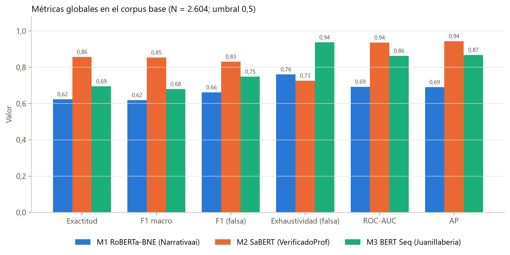
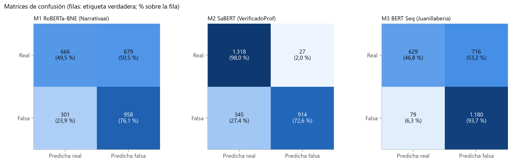
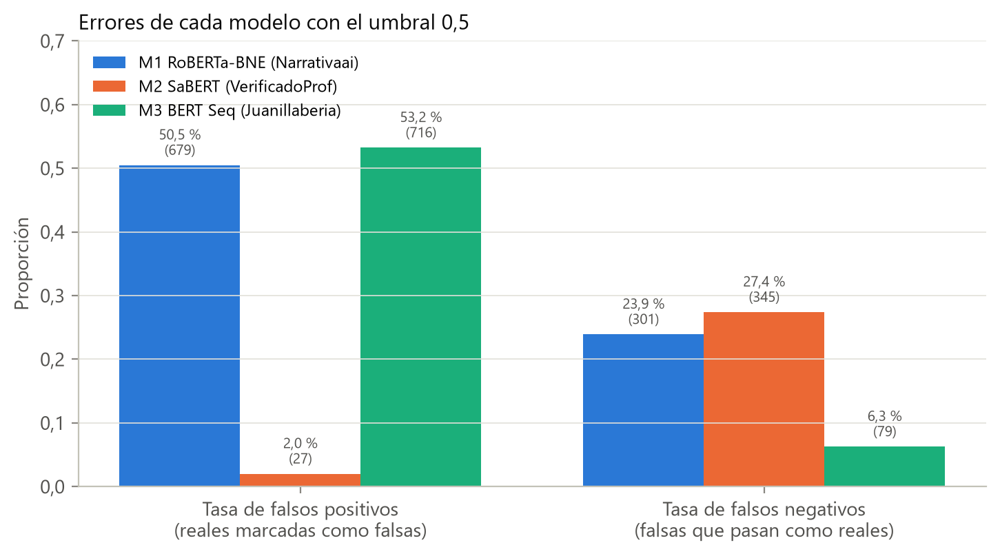
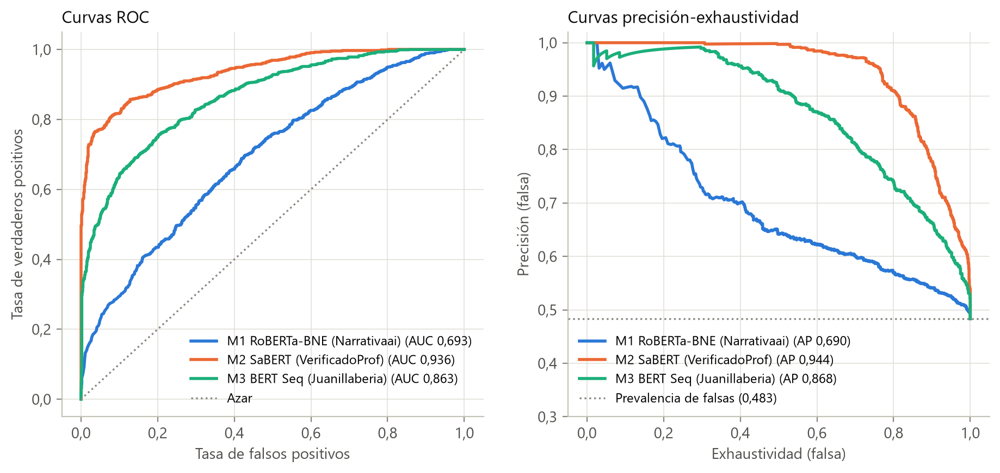
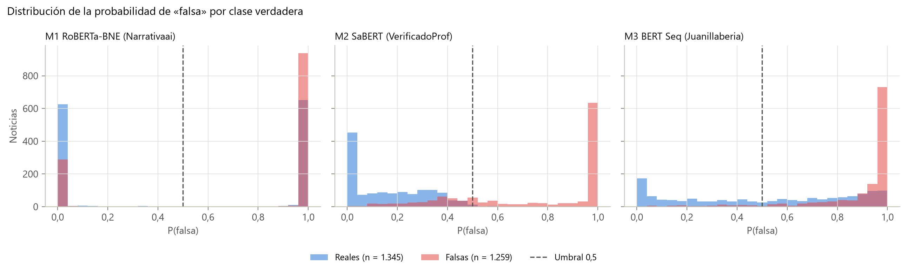
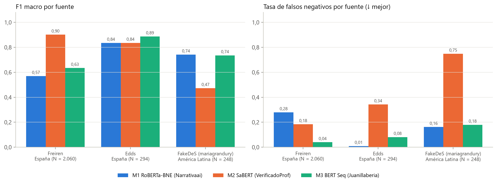
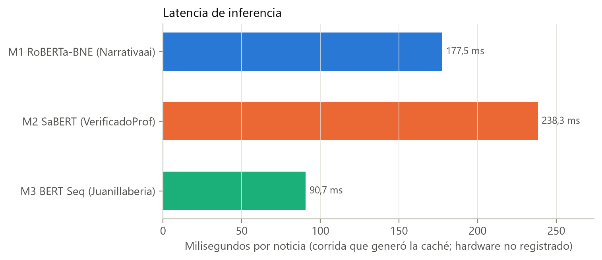

# Clasificadores de noticias falsas de la literatura: comparación en el corpus base

Esta carpeta compara tres clasificadores de noticias falsas en español publicados en Hugging Face, usados tal como se publicaron (sin ajuste fino), sobre las 2.604 noticias del corpus base. Es la primera etapa del objetivo específico 1: delimita cuál es el mejor modelo disponible y muestra que su desempeño depende de la fuente, lo que motiva la evaluación de SaBERT en el corpus ampliado (`../SABERT_Evaluacion/`).

## 1. Relación con la tesis

| Elemento de la tesis | Qué respalda esta carpeta |
|:---|:---|
| Sección 3.3.1 y Tabla 3.3 (Clasificadores evaluados) | Identificadores, revisiones fijas e índice de la clase falsa de M1, M2 y M3 |
| Sección 3.3.2 (Protocolo) | Inferencia sin ajuste, truncamiento a 256 subpalabras, umbral 0,5 |
| Sección 4.1.1 y Tabla 4.1 | `Reportes/metricas_3_modelos_fakenews.json` (bloque `modelos`) |
| Figura 4.1 (Métricas globales) | `Reportes/Imagenes/metricas_globales_3_modelos.png` |
| Figura 4.2 (Desempeño por fuente) | `Reportes/Imagenes/desempeno_por_fuente_3_modelos.png` (bloque `por_fuente`) |
| Apéndice A.3, Tabla A.2 | Revisiones de los modelos y parámetros de inferencia |

## 2. Datos de entrada

- **Corpus:** `../Dataset/Noticias_entre_70_y_370_palabras (1).xlsx` (2.604 noticias: 1.345 reales y 1.259 falsas). Procedencia y licencias en [`../Dataset/README.md`](../Dataset/README.md).
- **Columnas usadas:** `Text`, `label_num` (**1 = falsa**, 0 = real), `class` (booleano, True = real; se usa como control de consistencia con `label_num`) y `Fuente` (URL del repositorio, para el desglose por fuente y región).

| Repositorio | Región | N | Reales (0) | Falsas (1) |
|:---|:---|---:|---:|---:|
| Unified (Freiren) | España | 2.060 | 1.081 | 979 |
| Edds | España | 294 | 183 | 111 |
| FakeDeS (mariagrandury) | América Latina | 248 | 81 | 167 |
| Kaggle (arseniitretiakov) | Sin región | 2 | 0 | 2 |

**Modelos** (revisión fija en `config_proyecto.MODELOS_HF`):

| Clave | Identificador | Revisión | Arquitectura | Salida de la clase falsa | Datos de ajuste declarados en la ficha |
|:---|:---|:---|:---|:---|:---|
| M1 | `Narrativaai/fake-news-detection-spanish` | `0eab6d9` | RoBERTa-large-BNE | índice 1 (declarado en `id2label`) | FakeDeS |
| M2 | `VerificadoProfesional/SaBERT-Spanish-Fake-News` | `c092c97` | BERT-base (SaBERT) | índice 0 (declarado; `False` = noticia falsa) | unas 125.000 noticias en español, sin identificar los corpus |
| M3 | `Juanillaberia/spanish-fake-news-classifier` | `163af62` | BERT-base | índice 0 (empírico) | ajuste secuencial con noticias cortas y largas, sin identificar los corpus |

El índice de M3 se fijó de forma empírica porque su configuración no define etiquetas: con el índice 0 el ROC-AUC es 0,86, y con el 1 sería 0,14.

## 3. Cómo ejecutar

Desde la raíz del repositorio:

```bash
# Métricas, predicciones, figuras (llama al final a generar_reporte_3_modelos.py)
python Modelos_Individuales/Clasificar_fake/Modelos_Literatura/Codigos/run_3_modelos_fakenews.py
# Solo figuras, a partir del JSON y del CSV de predicciones
python Modelos_Individuales/Clasificar_fake/Modelos_Literatura/Codigos/generar_reporte_3_modelos.py
```

- **Desde la caché, sin GPU ni internet.** Si existe `Codigos/predictions_cache_2604.npz` y sus etiquetas coinciden con las del corpus, `run_3_modelos_fakenews.py` recalcula todas las métricas sin cargar los modelos (no necesita `torch` ni `transformers`); tarda unos segundos.
- **Inferencia completa.** Si se borra la caché, el script descarga los tres modelos en su revisión fija (requiere internet) y ejecuta la inferencia; usa GPU si está disponible y, si no, CPU. En la corrida que generó la caché, la inferencia tardó 462 s (M1), 621 s (M2) y 236 s (M3) sobre las 2.604 noticias, en un equipo cuyo hardware no quedó registrado.
- Para copiar las figuras a la carpeta de la tesis se define la variable de entorno `TESIS_IMG_DIR`.

## 4. Qué hace cada script y decisiones metodológicas

### `Codigos/run_3_modelos_fakenews.py`

| Paso | Decisión | Motivo |
|:---|:---|:---|
| Carga del corpus | Etiqueta desde `label_num`, verificada contra `class` con `etiqueta_binaria`; el script se detiene si no coinciden | Garantizar la convención falsa = 1 |
| Inferencia | Sin ajuste fino; revisión fija; textos ordenados por longitud y procesados por lotes (16 en M1 y M2, 32 en M3); truncamiento a 256 subpalabras; softmax y lectura de la posición de la clase falsa | Que el resultado refleje lo que el modelo aprendió en su entrenamiento y no un ajuste a estos datos (Sección 3.1) |
| Decisión | Regla común: falsa si P(falsa) ≥ 0,5 | Comparar los tres modelos con el mismo criterio |
| Métricas globales | Exactitud; precisión, exhaustividad y F1 de la clase falsa; métricas macro; ROC-AUC; AP; matriz de confusión con controles de consistencia | El F1 macro no favorece a la clase mayoritaria; ROC-AUC y AP no dependen del umbral |
| Desglose | Por repositorio y por región (España, América Latina, sin región) | Detectar dependencia de la fuente |
| Salidas | Caché `.npz`, CSV de predicciones por noticia y JSON de métricas | Recalcular sin repetir la inferencia |

### `Codigos/generar_reporte_3_modelos.py`

Lee el JSON y el CSV, comprueba que las predicciones están alineadas con el corpus base y dibuja las siete figuras de `Reportes/Imagenes/` (además de un resumen auxiliar en Markdown). Las fuentes con menos de 30 noticias (Kaggle) se excluyen de las figuras por fuente.

## 5. Resultados principales

**Tabla 4.1 de la tesis** (2.604 noticias; umbral 0,5; F = clase falsa):

| Modelo | Exactitud | F1 macro | Precisión (F) | Exhaustividad (F) | ROC-AUC | AP | FP | FN |
|:---|---:|---:|---:|---:|---:|---:|---:|---:|
| M1 RoBERTa-BNE | 0,624 | 0,619 | 0,585 | 0,761 | 0,693 | 0,690 | 679 | 301 |
| **M2 SaBERT** | **0,857** | **0,854** | **0,971** | 0,726 | **0,936** | **0,944** | **27** | 345 |
| M3 BERT | 0,695 | 0,680 | 0,622 | **0,937** | 0,863 | 0,868 | 716 | **79** |



- **SaBERT es conservador:** 27 falsos positivos (especificidad 0,980), pero deja pasar 345 de las 1.259 falsas.
- **M3 prioriza la detección de falsas:** encuentra 1.180 (exhaustividad 0,937) a costa de 716 falsos positivos. Su ROC-AUC de 0,863, muy superior a su F1 macro, indica que ordena bien y que el umbral de 0,5 no es el adecuado para este corpus.
- **M1** tiene el desempeño global más bajo (ROC-AUC 0,693).









**El desempeño depende de la fuente (Figura 4.2).** F1 macro y tasa de falsos negativos (FN) por repositorio:

| Repositorio (N) | M1 F1 macro / FN | M2 SaBERT F1 macro / FN | M3 F1 macro / FN |
|:---|:---|:---|:---|
| Unified, España (2.060) | 0,569 / 27,9 % | **0,901** / 18,4 % | 0,635 / 4,0 % |
| Edds, España (294) | 0,835 / 0,9 % | 0,836 / 34,2 % | **0,887** / 8,1 % |
| FakeDeS, América Latina (248) | **0,742** / 16,2 % | 0,473 / 74,9 % | 0,736 / 18,0 % |



SaBERT es el mejor en Unified y el peor en FakeDeS, la única fuente latinoamericana del corpus base, mientras que M1, cuya ficha declara un ajuste con FakeDeS, rinde mejor justamente allí. El orden de los modelos cambia según la fuente y ninguno es el mejor en todas. Este cruce es compatible con que cada modelo rinda mejor donde sus datos de ajuste se parecen a los de evaluación, pero no puede confirmarse porque no se conocen con precisión los datos de entrenamiento de SaBERT ni de M3.



## 6. Limitaciones

- **Posible solapamiento con los datos de entrenamiento.** M1 declara FakeDeS, y Unified procede en su mayor parte de un corpus abierto de gran tamaño que pudo formar parte del ajuste de M2 o M3. Las métricas en el corpus base se interpretan como una **cota optimista**; el solapamiento es una amenaza plausible, no una contaminación demostrada (Sección 3.3.1).
- **Una sola fuente latinoamericana** (FakeDeS, 248 noticias, el 9,5 % del corpus); por eso la comparación regional se amplía en `../SABERT_Evaluacion/`.
- **Duplicados.** Las métricas se calculan sobre los 2.604 registros sin deduplicar (2.285 textos únicos); los textos de Edds están contenidos en Unified.
- **Umbral fijo** de 0,5 para todos los modelos; ROC-AUC y AP no dependen de él.
- **Tiempos de inferencia** dependientes del hardware de la corrida que generó la caché, que no quedó registrado; la caché tampoco guarda la revisión del modelo, que se asume igual a la fijada en `config_proyecto.py`.

## 7. Archivos generados

| Archivo | Contenido |
|:---|:---|
| `Codigos/predictions_cache_2604.npz` | `y_true` y, por modelo, `prob_*`, `pred_*` y `time_*` |
| `Reportes/predicciones_3_modelos_2604.csv` | Etiqueta, predicción y P(falsa) de cada modelo por noticia (mismo orden que el corpus base) |
| `Reportes/metricas_3_modelos_fakenews.json` | `metadata`, `modelos` (métricas globales y ficha técnica), `por_region` y `por_fuente` |
| `Reportes/Imagenes/*.png` | Siete figuras: métricas globales, matrices de confusión, curvas ROC/PR, distribución de probabilidades, errores, desempeño por fuente y latencia |
| `Reportes/Reporte_3_Modelos_FakeNews.md` | Resumen auxiliar generado automáticamente al ejecutar los scripts |
