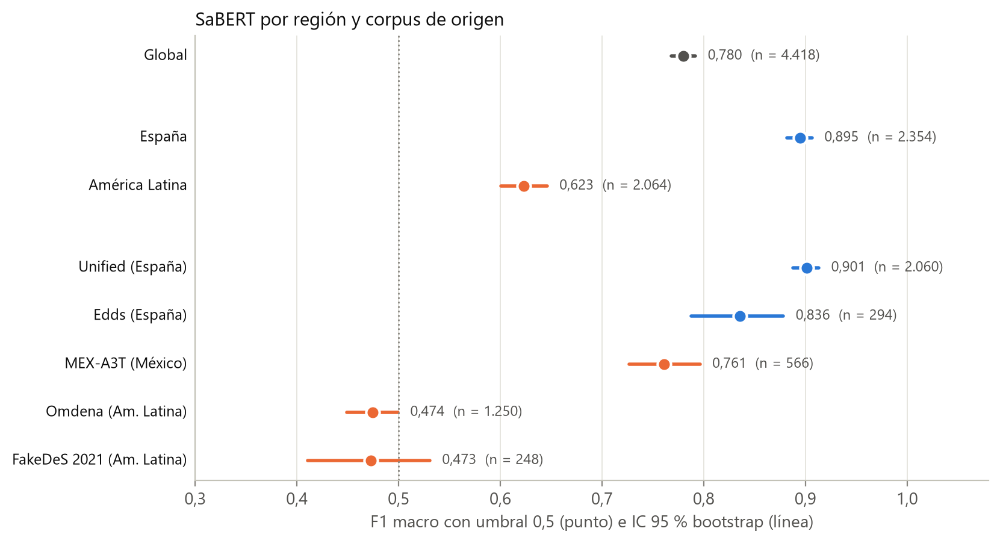
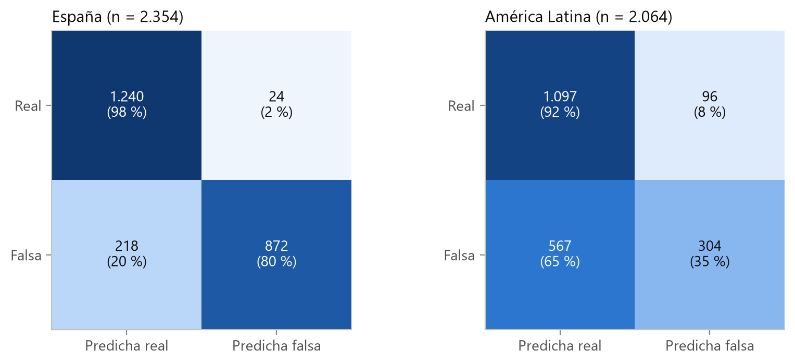
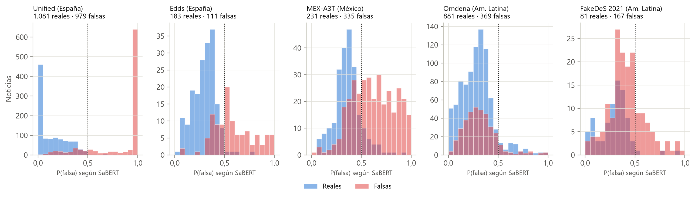
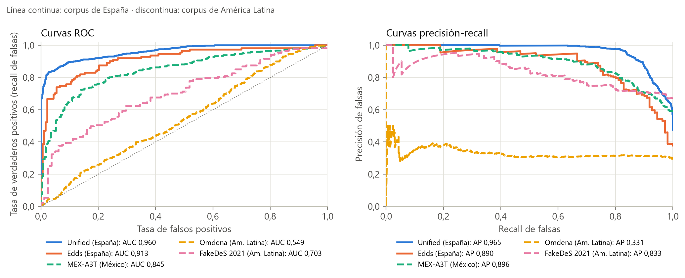
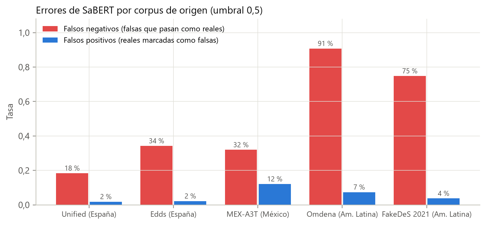
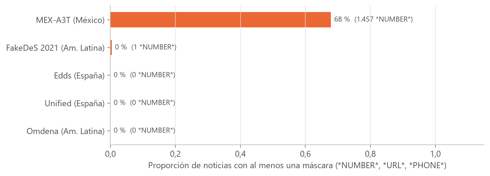
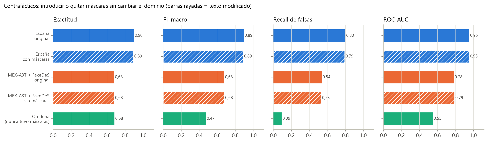

# SaBERT en el corpus ampliado: región, fuente y máscaras de anonimización

Esta carpeta evalúa SaBERT, el mejor clasificador del corpus base (`../Modelos_Literatura/`), sobre las 4.418 noticias del corpus ampliado, desagrega su desempeño por región y por fuente, y separa mediante dos experimentos contrafácticos el efecto de las máscaras de anonimización (`*NUMBER*`, `*URL*`, `*PHONE*`) del efecto del cambio de dominio. Completa el objetivo específico 1.

## 1. Relación con la tesis

| Elemento de la tesis | Qué respalda esta carpeta |
|:---|:---|
| Sección 3.3.2 (Protocolo) | Evaluación por región y fuente; verificación de las predicciones guardadas con la revisión fija |
| Sección 3.3.3 (Máscaras frente a cambio de dominio) | Contrafácticos A y B y comparación observacional |
| Sección 4.1.2, Tabla 4.2 | `Reportes/metricas_sabert_dataset_ampliado_4418.json` (`global`, `regiones`, `corpus_origen`) |
| Figura 4.3 | `Reportes/Imagenes/f1_macro_region_corpus.png` |
| Figura 4.4 | `Reportes/Imagenes/distribucion_probabilidad_por_corpus.png` |
| Sección 4.1.3, Tabla 4.3 | `Reportes/auditoria_censura_vs_domain_shift.json` (`metricas_estratificadas`, `contrafactico_*`, `deltas`) |
| Figura 4.5 | `Reportes/Imagenes/contrafacticos_mascaras_vs_dominio.png` |
| Sección 4.5.2 (Memorización, generalización y dominio) | Lectura de la caída en América Latina y en Omdena |

## 2. Datos de entrada

| Archivo | Contenido |
|:---|:---|
| `../Dataset/predicciones_sabert_ampliado_4418.csv` | Las 4.418 noticias con `clase_num` (**1 = falsa**, 0 = real), `region`, `dataset_origen`, `Fuente` y `prob_fake` = P(falsa) de SaBERT |
| `../Dataset/Noticias_entre_70_y_370_palabras_AMPLIADO_LATAM.csv` | Corpus ampliado; se usa para comprobar que textos y etiquetas de las predicciones coinciden con el corpus vigente |

Procedencia de cada fuente (URL), licencias y convención de etiquetas en [`../Dataset/README.md`](../Dataset/README.md). Modelo: `VerificadoProfesional/SaBERT-Spanish-Fake-News`, revisión `c092c970eda10216ea2da846813745c0074a6ca2`, salida de la clase falsa en el índice 0, máximo 256 subpalabras.

Las probabilidades de `predicciones_sabert_ampliado_4418.csv` son una caché de inferencia. Su procedencia se verifica recalculando SaBERT con la revisión fija sobre una muestra estratificada de 60 noticias (12 por fuente, semilla 42): la diferencia absoluta máxima es de 3,0 × 10⁻⁷ y la predicción coincide en el 100 % de los casos.

## 3. Cómo ejecutar

Desde la raíz del repositorio, en este orden:

```bash
# 1. Máscaras, métricas estratificadas, contrafácticos y verificación
python Modelos_Individuales/Clasificar_fake/SABERT_Evaluacion/Codigos/auditoria_censura_vs_domain_shift.py
# 2. Métricas por región, fuente y corpus con IC bootstrap, y figuras
python Modelos_Individuales/Clasificar_fake/SABERT_Evaluacion/Codigos/generar_reporte_sabert.py
```

- **Desde la caché, sin GPU ni internet.** Las probabilidades de los textos contrafácticos y de la muestra de verificación están en `Reportes/datos/`. Si existen y sus textos coinciden con los que genera el script, no se carga el modelo y ambos pasos se completan en segundos o pocos minutos (el paso 2 incluye 1.000 remuestreos *bootstrap* por grupo).
- **Recalcular la inferencia.** `auditoria_censura_vs_domain_shift.py --recalcular` ignora la caché, descarga SaBERT en su revisión fija (requiere internet) y vuelve a calcular las probabilidades de unos 3.200 textos (2.354 de España, 814 de MEX-A3T y FakeDeS y 60 de verificación); usa GPU si está disponible.

## 4. Qué hace cada script y decisiones metodológicas

### `Codigos/auditoria_censura_vs_domain_shift.py`

| Paso | Detalle | Motivo |
|:---|:---|:---|
| Conteo de máscaras | Expresiones regulares para `*NUMBER*` (también `*<dígitos>*`), `*URL*` y `*PHONE*`, sin distinguir mayúsculas | Medir dónde se concentran las máscaras |
| Métricas estratificadas | Global, España, América Latina, Omdena, MEX-A3T + FakeDeS y, dentro de MEX-A3T, textos con y sin máscara | La comparación con y sin máscara se hace dentro de MEX-A3T porque FakeDeS casi no tiene máscaras y SaBERT rinde peor en él; mezclarlos favorecería artificialmente a los textos con máscara |
| Contrafáctico A | En España, cada enlace (`http…`, `www…`) se reemplaza por `*URL*` y cada cifra (`\b\d+([.,]\d+)?\b`) por `*NUMBER*` | Introducir solo la máscara manteniendo fijo el dominio |
| Contrafáctico B | En MEX-A3T y FakeDeS, `*NUMBER*` → `20`, `*URL*` → `https://www.portalnoticias.com`, `*PHONE*` → `5512345678` | Retirar solo la máscara con valores plausibles y ficticios manteniendo fijo el dominio |
| Deltas | Contrafáctico − original; Omdena − España; América Latina − España | Comparar el tamaño del efecto de las máscaras con el del cambio de fuente |
| Verificación | Muestra estratificada de 60 noticias recalculada con la revisión fija | Comprobar que la caché corresponde al modelo declarado |

Todas las métricas usan el umbral 0,5 sobre P(falsa): exactitud, F1 macro, precisión, exhaustividad y F1 de la clase falsa, ROC-AUC, AP y tasas de falsos negativos y positivos.

### `Codigos/generar_reporte_sabert.py`

Calcula las métricas globales, por región, por corpus de origen y por URL de fuente, con un intervalo de confianza del 95 % del F1 macro obtenido por *bootstrap* no paramétrico sobre las noticias (1.000 remuestreos, percentiles 2,5 y 97,5, semilla 42; Sección 3.7.2). Dibuja las siete figuras de `Reportes/Imagenes/` (además de un resumen auxiliar en Markdown).

## 5. Resultados principales

**Por región y fuente (Tabla 4.2 de la tesis; umbral 0,5).** Tasa FN: proporción de noticias falsas clasificadas como reales.

| Grupo | Región | n | F1 macro [IC 95 %] | Exhaustividad (F) | Tasa FN | ROC-AUC |
|:---|:---|---:|:---|---:|---:|---:|
| Global | | 4.418 | 0,780 [0,768; 0,792] | 0,600 | 40,0 % | 0,859 |
| España | | 2.354 | 0,895 [0,882; 0,907] | 0,800 | 20,0 % | 0,954 |
| América Latina | | 2.064 | 0,623 [0,600; 0,646] | 0,349 | 65,1 % | 0,692 |
| Unified | España | 2.060 | 0,901 [0,888; 0,913] | 0,816 | 18,4 % | 0,960 |
| Edds | España | 294 | 0,836 [0,788; 0,878] | 0,658 | 34,2 % | 0,913 |
| MEX-A3T | América Latina | 566 | 0,761 [0,726; 0,796] | 0,681 | 31,9 % | 0,845 |
| FakeDeS | América Latina | 248 | 0,473 [0,410; 0,531] | 0,251 | 74,9 % | 0,703 |
| Omdena | América Latina | 1.250 | 0,474 [0,449; 0,499] | 0,092 | 90,8 % | 0,549 |



- Los intervalos de España y América Latina no se solapan. La diferencia está en las falsas: el modelo deja pasar una de cada cinco en España y dos de cada tres en América Latina, mientras que la tasa de falsos positivos sube poco (del 1,9 % al 8,0 %).
- En Omdena el modelo queda cerca del azar (ROC-AUC 0,549) y solo reconoce el 9,2 % de las falsas. Como el ROC-AUC también es bajo, el problema no se resolvería moviendo el umbral.









**Máscaras.** Se concentran en MEX-A3T: 384 de sus 566 noticias (67,8 %), con 1.457 cifras reemplazadas por `*NUMBER*`, 7 `*URL*` y 1 `*PHONE*`; FakeDeS tiene una sola noticia con máscara y las demás fuentes ninguna.



**Contrafácticos (Tabla 4.3 de la tesis).**

| Escenario | n | Exactitud | F1 macro | Exhaustividad (F) | ROC-AUC |
|:---|---:|---:|---:|---:|---:|
| España, original | 2.354 | 0,897 | 0,895 | 0,800 | 0,954 |
| España, con máscaras (A) | 2.354 | 0,891 | 0,888 | 0,793 | 0,952 |
| MEX-A3T y FakeDeS, original | 814 | 0,677 | 0,677 | 0,538 | 0,782 |
| MEX-A3T y FakeDeS, sin máscaras (B) | 814 | 0,678 | 0,678 | 0,532 | 0,790 |
| MEX-A3T, textos con máscara | 384 | 0,755 | 0,753 | 0,623 | 0,823 |
| MEX-A3T, textos sin máscara | 182 | 0,775 | 0,746 | 0,771 | 0,863 |
| Omdena (sin máscaras) | 1.250 | 0,680 | 0,474 | 0,092 | 0,549 |



1. **A, introducir máscaras:** en España se reemplazaron 4.282 cifras y los enlaces, lo que modificó el 58,8 % de los textos (1.384). La exactitud bajó 0,6 puntos porcentuales, el F1 macro 0,006 y el ROC-AUC 0,001.
2. **B, retirar máscaras:** se modificaron 385 textos (384 de MEX-A3T y 1 de FakeDeS). La exactitud subió 0,1 puntos porcentuales y el ROC-AUC 0,008.
3. **Comparación observacional:** dentro de MEX-A3T, los textos con y sin máscara tienen un F1 macro similar (0,753 y 0,746); al ser textos distintos, no aísla el efecto de las máscaras.

Las máscaras mueven las métricas menos de un punto en ambas direcciones, mientras que Omdena, sin ninguna máscara, queda 0,405 por debajo de España en ROC-AUC y 0,420 en F1 macro. **La diferencia regional de SaBERT no se debe a la anonimización.** El diseño tampoco permite atribuirla a la región: cada región es un conjunto distinto de fuentes, con sus propios temas, entidades, épocas, proporciones de clase, forma de redactar y criterios de anotación.

## 6. Limitaciones

- **Región confundida con la fuente:** «España» y «América Latina» designan los conjuntos de fuentes de cada región.
- **Posible solapamiento con el entrenamiento de SaBERT.** Su ficha declara unas 125.000 noticias en español sin identificar los corpus; si incluyen parte de Unified, el desempeño en España es una cota optimista de lo que lograría con noticias nuevas.
- **Criterios de anotación distintos por fuente**; las etiquetas de Omdena proceden de una corrección del propio proyecto, y sus noticias son mayoritariamente políticas.
- **Umbral fijo de 0,5**; el ROC-AUC, que no depende de él, se reporta junto a las métricas con umbral.
- Las métricas se calculan sobre los 4.418 registros sin deduplicar; con el protocolo del clasificador interpretable (4.100 textos únicos y umbral anidado), las cifras de SaBERT difieren (Sección 4.4).
- La comparación observacional dentro de MEX-A3T no es causal, porque los textos con y sin máscara son distintos; la evidencia causal son los contrafácticos.

## 7. Archivos generados

| Archivo | Contenido |
|:---|:---|
| `Reportes/auditoria_censura_vs_domain_shift.json` | Máscaras por fuente, métricas estratificadas, contrafácticos A y B, deltas y verificación de procedencia |
| `Reportes/metricas_sabert_dataset_ampliado_4418.json` | Métricas global, por región, por corpus de origen y por fuente, con IC 95 % del F1 macro |
| `Reportes/datos/probs_contrafactico_espana_enmascarada.csv` | P(falsa) de los 2.354 textos de España enmascarados (caché) |
| `Reportes/datos/probs_contrafactico_mex_fakedes_restaurado.csv` | P(falsa) de los 814 textos de MEX-A3T y FakeDeS sin máscaras (caché) |
| `Reportes/datos/probs_verificacion_muestra.csv` | P(falsa) recalculada en la muestra de verificación (caché) |
| `Reportes/Imagenes/*.png` | Siete figuras citadas arriba |
| `Reportes/Reporte_Evaluacion_SaBERT_Domain_Shift.md` | Resumen auxiliar generado automáticamente al ejecutar `generar_reporte_sabert.py` |
