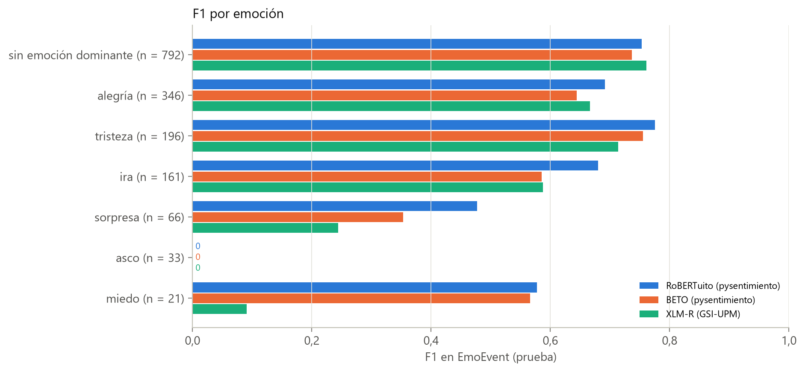

# Emociones: selección y validación del instrumento

Natali Alba Tobías y Daniel Santiago Camacho Gutiérrez

Esta carpeta documenta la elección del clasificador de emociones que alimenta la familia de variables E (pilar 2, carga emocional) del Modelo sobre Variables, la dimensión D2 del índice de manipulación lingüística y los estilos discursivos. Se compararon tres modelos publicados, sin ajuste fino, sobre la partición de prueba de EmoEvent, y se eligió **RoBERTuito** (`pysentimiento/robertuito-emotion-analysis`). Ningún modelo alcanza el valor de referencia F1 macro ≥ 0,65.

## Relación con la tesis

| Elemento de la tesis | Contenido respaldado por esta carpeta |
|:---|:---|
| Sección 3.4.1, «Instrumentos de medición y su validación» (párrafo *Emociones*) | Modelos candidatos, corrección de etiquetas de EmoEvent, regla de selección y muestra de 301 noticias |
| Sección 4.2.1, «Validación de los instrumentos» | F1 macro de los tres modelos, desempate y acuerdo en noticias |
| Figura 4.8 | [`Reportes/Imagenes/f1_por_emocion_y_modelo.png`](Reportes/Imagenes/f1_por_emocion_y_modelo.png) |
| Anexo A.3 | Revisión del modelo (`bcd6835`), preprocesamiento de `pysentimiento` y 128 subpalabras |
| Capítulo 5 (limitaciones de los instrumentos) | El modelo se validó sobre tuits y no sobre noticias |


## Datos de entrada

| Conjunto (archivo) | Procedencia | Licencia | Tamaño | Rol | Etiqueta |
|:---|:---|:---|---:|:---|:---|
| EmoEvent, prueba (`Dataset/externos/emoevent/test.tsv`) | Plaza-del-Arco, Strapparava, Ureña-López y Martín-Valdivia (2020), *EmoEvent*, LREC 2020; corpus de la tarea EmoEvalEs (IberLEF 2021). Partición `splits/es` de [fmplaza/EmoEvent](https://github.com/fmplaza/EmoEvent), descargada el 2026-10-24 | El repositorio no declara licencia | 1.656 filas; 1.615 tuits evaluados | Prueba con etiquetas humanas | 7 clases: `others` (sin emoción dominante), alegría, tristeza, ira, sorpresa, asco y miedo |
| EmoEvent, corpus completo (`Dataset/externos/emoevent/emoevent_es.csv`) | Mismo repositorio; 8.409 tuits con enlaces, etiquetas y usuarios reemplazados por `URL`, `HASHTAG`, `USER` | Ídem | 8.409 | Fuente de las etiquetas corregidas de prueba | Ídem |
| EmoEvent, `train.tsv` y `dev.tsv` | Mismo repositorio | Ídem | 5.723 y 844 | Solo para validar el cruce de etiquetas; con ellos se entrenaron los modelos evaluados | Ídem |
| Muestra de noticias (`Modelos_Individuales/Clasificar_fake/Dataset/Noticias_entre_70_y_370_palabras_AMPLIADO_LATAM.csv`) | Corpus ampliado de la tesis, sin duplicados; muestra estratificada por región y clase (semilla 42) | Ver `Clasificar_fake/Dataset/` | 301 (América Latina 87 reales / 63 falsas; España 79 / 72) | Acuerdo entre modelos y distribución de emociones | Sin etiquetas de emoción |

Distribución de la prueba (1.615 tuits): sin emoción dominante 792, alegría 346, tristeza 196, ira 161, sorpresa 66, asco 33, miedo 21.

**Corrección de etiquetas.** En `test.tsv` la columna `emotion` está desplazada 30 filas respecto de los textos: el archivo termina con 30 filas que solo tienen etiqueta. La etiqueta de cada tuit de prueba se toma del corpus completo, cruzando por el texto normalizado (función `etiquetas_test_corregidas`). El cruce se valida en las otras particiones:

| Partición | Filas | Sin texto | Encontradas en el corpus completo | Etiqueta del archivo = etiqueta del corpus |
|:---|---:|---:|---:|---:|
| train | 5.723 | 0 | 5.683 | 99,98 % |
| dev | 844 | 0 | 831 | 100,00 % |
| test | 1.656 | 30 | 1.615 | 35,05 % |

Los 30 tuits sin texto y los 11 que no se encuentran en el corpus completo se excluyen. Los archivos descargados no se modifican; se leen con `sep='\t'` y `quoting=3`, como en el repositorio original.

## Modelos comparados

| Clave | Modelo de Hugging Face (revisión fija) | Referencia | Preprocesamiento |
|:---|:---|:---|:---|
| `robertuito_pysentimiento` | `pysentimiento/robertuito-emotion-analysis` (`bcd6835`) | Pérez et al. (2021, 2022): `pysentimiento` y RoBERTuito | `pysentimiento` |
| `beto_pysentimiento` | `finiteautomata/beto-emotion-analysis` (`9b628b0`) | Pérez et al. (2021); BETO (Cañete et al., 2020) | `pysentimiento` |
| `xlmr_emoevales_gsiupm` | `daveni/twitter-xlm-roberta-emotion-es` (`ab57a11`) | Vera et al. (2021), GSI-UPM, EmoEvalEs; XLM-T (Barbieri et al., 2022) | XLM-T (`@user`, `http`) |

## Cómo ejecutar

Desde la raíz del repositorio (requiere `pysentimiento`, instalado como indica el README principal):

```bash
python Modelos_Individuales/Emociones/Evaluacion_Modelos/evaluar_modelos_emociones.py
python Modelos_Individuales/Emociones/Evaluacion_Modelos/generar_reporte_emociones.py
```

| Script | Qué hace | Requisitos |
|:---|:---|:---|
| `evaluar_modelos_emociones.py` | Corrige las etiquetas de prueba, obtiene las 7 probabilidades de cada modelo (reordenadas por nombre de clase), calcula métricas con IC por *bootstrap* y el acuerdo entre modelos en noticias. Escribe `Reportes/metricas_modelos_emociones.json` | Solo infiere lo que falta en `Evaluacion_Modelos/cache/`. Sin caché: internet para descargar los modelos y unos 12 minutos de CPU (la inferencia no usa GPU) |
| `generar_reporte_emociones.py` | Aplica la regla de selección y genera las cinco figuras de `Reportes/Imagenes/`; comprueba que la caché reproduce la intensidad del JSON | Sin GPU ni internet |

La caché versionada (`Evaluacion_Modelos/cache/*.npy`: 3 modelos × 2 conjuntos, con sus `__meta.json`) reproduce todas las cifras y figuras sin descargar modelos.

## Decisiones metodológicas

| Decisión | Detalle |
|:---|:---|
| Sin ajuste fino ni umbral | La clase predicha es la de mayor probabilidad entre las 7 |
| Lectura por nombre | Las salidas se reordenan según `id2label`, porque el orden de los índices difiere entre modelos (el índice 0 es `others` en `pysentimiento` y `sadness` en el de GSI-UPM) |
| Regla de selección (fijada antes de ver los resultados) | Mayor F1 macro de 7 clases en EmoEvent prueba; si los IC 95 % se solapan, desempate por el F1 macro de las 6 emociones (sin `others`) |
| Valor de referencia | F1 macro ≥ 0,65, el mismo criterio de aceptación del sensacionalismo |
| Truncado | 128 subpalabras para tuits; 256 para noticias, acotado por el modelo: RoBERTuito admite como máximo 128 |
| Incertidumbre | IC 95 % del F1 macro por *bootstrap* percentil (1.000 remuestreos, semilla 42) |
| Transferencia a noticias | Acuerdo entre modelos (κ de Cohen) en la muestra de 301 noticias, a falta de un corpus de noticias anotado con emociones |

## Resultados

EmoEvent, partición de prueba (1.615 tuits):

| Modelo | F1 macro [IC 95 %] | F1 macro 6 emociones | Exactitud | AUC macro (OvR) |
|:---|:---|---:|---:|---:|
| **RoBERTuito** | **0,565** [0,529; 0,595] | 0,534 | 0,714 | 0,917 |
| BETO | 0,520 [0,485; 0,549] | 0,484 | 0,671 | 0,879 |
| XLM-R (GSI-UPM) | 0,438 [0,407; 0,472] | 0,384 | 0,692 | 0,889 |

Los IC de RoBERTuito y BETO se solapan; la elección se confirma con el desempate (0,534 frente a 0,484). Ningún modelo alcanza 0,65.

F1 por emoción de RoBERTuito: tristeza 0,78, sin emoción dominante 0,75, alegría 0,69, ira 0,68, miedo 0,58 (21 tuits), sorpresa 0,48 (66 tuits) y asco 0,00 (33 tuits). Ninguno de los tres modelos reconoce el asco; RoBERTuito nunca lo predice y lo confunde sobre todo con ira.

Muestra de 301 noticias:

| Modelo | Sin emoción dominante | Ira | Intensidad emocional media (1 − P(others)) |
|:---|---:|---:|---:|
| RoBERTuito | 78,4 % | 14,0 % | 0,262 |
| BETO | 79,1 % | 15,9 % | 0,275 |
| XLM-R (GSI-UPM) | 86,7 % | 3,3 % | 0,305 |

κ de Cohen entre pares de modelos: 0,450 (RoBERTuito–BETO), 0,393 (RoBERTuito–XLM-R) y 0,308 (BETO–XLM-R); acuerdo moderado.



| Figura | Contenido |
|:---|:---|
| [F1 macro por modelo](Reportes/Imagenes/f1_macro_por_modelo.png) | F1 macro de 7 clases con IC y de 6 emociones |
| [F1 por emoción y modelo](Reportes/Imagenes/f1_por_emocion_y_modelo.png) | F1 de cada emoción con su soporte (Figura 4.8) |
| [Matriz de confusión](Reportes/Imagenes/matriz_confusion_modelo_elegido.png) | RoBERTuito, porcentaje por fila |
| [Emoción dominante en noticias](Reportes/Imagenes/emocion_dominante_en_noticias.png) | Distribución predicha por cada modelo en la muestra |
| [Intensidad emocional por clase](Reportes/Imagenes/intensidad_emocional_noticias_por_clase.png) | RoBERTuito por región y clase; descriptiva, sin prueba estadística |

## Limitaciones

1. La validación con etiquetas humanas se hizo sobre tuits, no sobre noticias; la transferencia al dominio solo se examina indirectamente.
2. Las clases minoritarias (sorpresa, asco, miedo) tienen pocos ejemplos y F1 inestable; el asco no se reconoce.
3. RoBERTuito lee como máximo 128 subpalabras por entrada. En esta muestra eso equivale al comienzo de la noticia; en las variables de la tesis el modelo se aplica por oración.
4. Las etiquetas de prueba dependen de la corrección del desplazamiento descrita arriba.
5. No se hizo ajuste fino, por decisión metodológica.

## Archivos generados

| Archivo | Generado por |
|:---|:---|
| `Reportes/metricas_modelos_emociones.json` | `evaluar_modelos_emociones.py`; métricas por modelo y clase, matrices de confusión, diagnóstico de etiquetas y acuerdo en noticias |
| `Evaluacion_Modelos/cache/<modelo>__<conjunto>.npy`, `<modelo>__meta.json` | `evaluar_modelos_emociones.py`; probabilidades en el orden común de clases, revisión, `id2label`, longitudes efectivas y tiempos |
| `Reportes/Imagenes/*.png` (5 figuras) | `generar_reporte_emociones.py` |
| `Reportes/Reporte_Evaluacion_Modelos_Emociones.md` | `generar_reporte_emociones.py`; reporte extendido que se regenera bajo demanda y no se incluye en el repositorio |

El modelo elegido y su longitud máxima se registran en `config_proyecto.py` (`MODELOS_HF["Emociones_RoBERTuito"]`).
