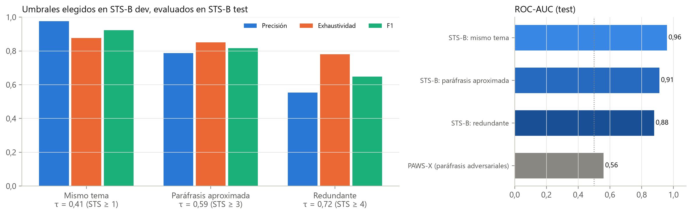

# Redundancia semántica: validación del codificador y umbrales

Natali Alba Tobías y Daniel Santiago Camacho Gutiérrez

Esta carpeta documenta el instrumento que mide la redundancia semántica entre oraciones de una misma noticia (pilar 3, familia R de variables y dimensión D3, «reiteración», del índice de manipulación lingüística). Se usa un único codificador, `hiiamsid/sentence_similarity_spanish_es` (Sentence-BERT sobre BETO, revisión `66ab46a`), elegido por estar entrenado para similitud de oraciones en español; no se hizo una comparación formal con otros codificadores. Aquí se valida su coseno frente al juicio humano, se calibran tres umbrales con significado explícito y se describe la redundancia del corpus base y su relación con la veracidad.

## Relación con la tesis

| Elemento de la tesis | Contenido respaldado por esta carpeta |
|:---|:---|
| Sección 3.4.1, «Instrumentos de medición y su validación» (párrafo *Similitud semántica*) | Bancos de validación, índice de Youden y significado de los umbrales |
| Sección 4.2.1, «Validación de los instrumentos» | Spearman 0,823 y Pearson 0,828 en STS-B; AUC 0,560 en PAWS-X |
| Tabla 4.5 | Umbrales calibrados en STS-B dev y evaluados en test |
| Figura 4.7 | [`Reportes/Imagenes/calidad_umbrales_sts_y_pawsx.png`](Reportes/Imagenes/calidad_umbrales_sts_y_pawsx.png) |
| Sección 4.2.2 y Figura 4.9 | Redundancia y veracidad en el corpus base: [`Reportes/Imagenes/redundancia_por_clase.png`](Reportes/Imagenes/redundancia_por_clase.png) |
| Anexo A.3 | Revisión del modelo y representaciones normalizadas |


## Datos de entrada

| Conjunto (archivo) | Procedencia | Licencia | Tamaño | Rol | Clase positiva |
|:---|:---|:---|---:|:---|:---|
| STS-B en español (`Dataset/benchmarks_externos/stsb_es_dev.parquet`, `stsb_es_test.parquet`) | STS Benchmark (Cer et al., 2017) traducido, [PhilipMay/stsb_multi_mt](https://huggingface.co/datasets/PhilipMay/stsb_multi_mt); pares puntuados por personas de 0 a 5 | Ver la tarjeta del conjunto | dev 1.500; test 1.379 pares | dev: calibración de umbrales; test: evaluación | Puntaje ≥ 1, ≥ 3 o ≥ 4 según el umbral |
| PAWS-X en español (`Dataset/benchmarks_externos/pawsx_es_validation.parquet`, `pawsx_es_test.parquet`) | Yang et al. (2019), [google-research-datasets/paws-x](https://huggingface.co/datasets/google-research-datasets/paws-x); pares adversarios con alto solapamiento léxico | Uso libre con reconocimiento a Google LLC | validation 2.000; test 2.000 pares | Validación externa | `label = 1` (paráfrasis) |
| Corpus base (`Modelos_Individuales/Clasificar_fake/Dataset/Noticias_entre_70_y_370_palabras (1).xlsx`) | Corpus base de la tesis (Sección 3.2.1) | Ver `Clasificar_fake/Dataset/` | 2.604 noticias | Aplicación y asociación descriptiva | 1 = falsa (`config_proyecto.etiqueta_binaria`; la columna `class` vale `True` en las reales) |

Segmentación: Punkt de NLTK en español, descartando segmentos de 8 caracteres o menos (la misma regla de `Explicabilidad_Propia/codigos/variables_texto.py` y de la tabla de variables).

## Cómo ejecutar

Desde la raíz del repositorio:

```bash
python Modelos_Individuales/Redundancia/pipeline_redundancia.py
python Modelos_Individuales/Redundancia/generar_reporte_redundancia.py
```

| Script | Qué hace | Requisitos |
|:---|:---|:---|
| `pipeline_redundancia.py` | (1) Calibra `tau_tema`, `tau_parafrasis` y `tau_redundante` en STS-B dev y los evalúa en test; (2) valida en PAWS-X; (3) codifica las 13.294 oraciones del corpus base y calcula las métricas por noticia; (4) contrasta falsas y reales en textos únicos | Internet (modelo de Hugging Face y recursos `punkt` de NLTK). Se ejecuta en CPU (`device='cpu'`): unos 32 minutos, 22 de ellos de codificación. No tiene caché de inferencia |
| `generar_reporte_redundancia.py` | Genera las tres figuras de `Reportes/Imagenes/` desde el JSON y el CSV del corpus, comprobando que coinciden | Sin modelo, GPU ni internet |

Sin volver a codificar se reproducen todas las figuras y las cifras del corpus, porque `Dataset/redundancia_corpus_hiiamsid.csv` guarda las similitudes de todos los pares. Las similitudes par a par de STS-B y PAWS-X no se guardaron: sus métricas solo se recalculan ejecutando el pipeline.

## Decisiones metodológicas

| Decisión | Detalle |
|:---|:---|
| Un solo codificador | `hiiamsid` con revisión fija en todas las etapas; embeddings normalizados, similitud = coseno |
| Umbrales con significado | Niveles de la guía de anotación de STS: mismo tema (≥ 1), paráfrasis aproximada (≥ 3), misma afirmación (≥ 4). Cada τ maximiza el índice de Youden en STS-B dev; se evalúa en test |
| PAWS-X | Umbral de Youden elegido en validation y medido en test; no se usa para fijar umbrales |
| Uso de los umbrales | Solo describen pares de oraciones en el auditor de estilo (`tau_redundante`). Las variables de redundancia del Modelo sobre Variables y del IML son continuas y no dependen de ellos |
| Asociación con la veracidad | Textos únicos con 2 o más oraciones; prueba U de Mann-Whitney, corrección de Holm, AUC univariado e IC 95 % de la diferencia de medianas por *bootstrap* (2.000 remuestreos, semilla 42). Sin umbrales ni estratos ajustados con las etiquetas |

## Resultados

Correlación del coseno con el juicio humano (STS-B test): Spearman = 0,823; Pearson = 0,828.

Umbrales (Tabla 4.5 de la tesis; métricas en STS-B test):

| Nivel (puntaje humano) | τ | AUC | Precisión | Exhaustividad | F1 |
|:---|---:|---:|---:|---:|---:|
| Mismo tema (≥ 1) | 0,413 | 0,959 | 0,976 | 0,876 | 0,923 |
| Paráfrasis aproximada (≥ 3) | 0,591 | 0,911 | 0,787 | 0,850 | 0,817 |
| Misma afirmación (≥ 4) | 0,723 | 0,878 | 0,554 | 0,781 | 0,648 |

PAWS-X test: AUC = 0,560, cercano al azar. Con el umbral de Youden de validation (0,974) la exactitud es 0,582 y el F1 0,359; con `tau_redundante` casi todos los pares se marcan como paráfrasis (exhaustividad 0,987, exactitud 0,460). El coseno mide similitud de contenido, no distingue paráfrasis finas.

Corpus base: 2.604 noticias, 2.471 con al menos dos oraciones (2.152 textos únicos) y 47.967 pares intra-documentales.

| Umbral | Pares sobre el umbral | Noticias con al menos un par sobre el umbral |
|:---|---:|---:|
| `tau_tema` | 27,1 % | 79,7 % |
| `tau_parafrasis` | 5,4 % | 33,2 % |
| `tau_redundante` | 0,9 % | 7,9 % |

Asociación con la veracidad (2.152 textos únicos): ninguna de las seis variables contrastadas difiere de forma significativa tras Holm (p ajustado mínimo = 0,451), y los AUC univariados quedan entre 0,486 y 0,503. Por ejemplo, la similitud máxima tiene mediana 0,515 en falsas y 0,513 en reales. La redundancia describe el estilo, pero no indica por sí sola falsedad.



| Figura | Contenido |
|:---|:---|
| [Calidad de los umbrales](Reportes/Imagenes/calidad_umbrales_sts_y_pawsx.png) | Precisión, exhaustividad y F1 en STS-B; AUC frente a PAWS-X (Figura 4.7) |
| [Distribución de similitudes](Reportes/Imagenes/distribucion_similitud_pares_y_umbrales.png) | Similitud de los 47.967 pares con los tres umbrales |
| [Redundancia por clase](Reportes/Imagenes/redundancia_por_clase.png) | Cuatro variables en reales y falsas, con mediana y AUC (Figura 4.9) |

## Limitaciones

1. La validez se midió en oraciones de propósito general (STS-B traducido), no en oraciones de noticias.
2. El coseno no separa paráfrasis de pares con las mismas palabras y distinto significado (PAWS-X).
3. `tau_redundante` tiene precisión moderada (0,554): parte de los pares marcados como «misma afirmación» son solo aproximadamente equivalentes.
4. No se compararon otros codificadores; la elección de `hiiamsid` no es resultado de una selección experimental.
5. El análisis de esta carpeta usa el corpus base (2.604). La redundancia del corpus ampliado (4.418), que usan el Modelo sobre Variables y el IML, está en `Clasificar_fake/Modelo_sobre_Variables/Dataset/tabla_variables_4418.csv` (variables `red_*`).

## Archivos generados

| Archivo | Generado por | Contenido |
|:---|:---|:---|
| `Dataset/redundancia_corpus_hiiamsid.csv` | `pipeline_redundancia.py` | Por noticia: número de oraciones y pares, similitud máxima, segunda, media, top-3, P90, varianza, consecutivas, pares y densidad sobre cada umbral, similitudes par a par (`pairwise_similarities`), `label_num` e `is_unique_text` |
| `Reportes/metricas_redundancia_hiiamsid.json` | `pipeline_redundancia.py` | Todas las cifras de este README |
| `Reportes/Imagenes/*.png` (3 figuras) | `generar_reporte_redundancia.py` | Ver la tabla de figuras |
| `Reportes/Reporte_Redundancia_hiiamsid.md` | `generar_reporte_redundancia.py` | Reporte extendido que se regenera bajo demanda; no se incluye en el repositorio |
