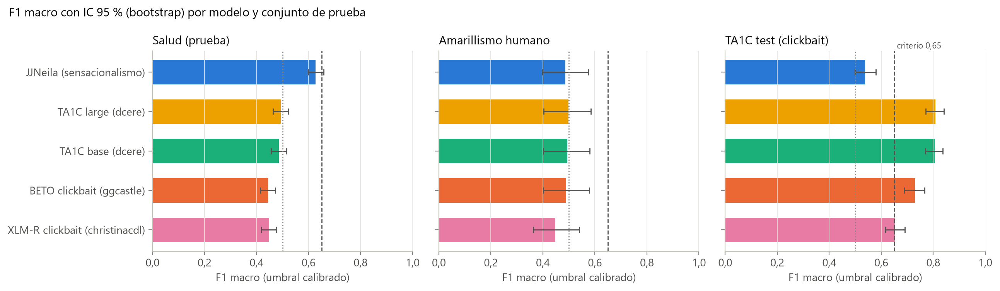

# Sensacionalismo: selección y validación del instrumento

Natali Alba Tobías y Daniel Santiago Camacho Gutiérrez

Esta carpeta documenta la elección del clasificador de sensacionalismo que alimenta la familia de variables S (pilar 1) del Modelo sobre Variables, del índice de manipulación lingüística (dimensión D1) y de los estilos discursivos. Se compararon cinco modelos publicados en Hugging Face, sin ajuste fino, y se eligió `JJNeila/bert-spanish-sensationalism-oss` con umbral calibrado τ = 0,85. El modelo **no alcanza** el criterio de aceptación fijado de antemano (F1 macro ≥ 0,65) y su probabilidad se usa en la tesis como un indicador de estilo débil y continuo.

## Relación con la tesis

| Elemento de la tesis | Contenido respaldado por esta carpeta |
|:---|:---|
| Sección 3.4.1, «Instrumentos de medición y su validación» (párrafo *Sensacionalismo*) | Conjuntos, regla de selección, umbral y criterio de aceptación |
| Sección 4.2.1, «Validación de los instrumentos» | Resultados del instrumento |
| Tabla 4.4 | F1 macro, IC 95 % y AUC de los cinco modelos en Salud y Amarillismo humano |
| Figura 4.6 | [`reportes/Imagenes/f1_macro_por_modelo_y_conjunto.png`](reportes/Imagenes/f1_macro_por_modelo_y_conjunto.png) |
| Anexo A.3 | Revisión del modelo (`1b8140e`) y longitudes de entrada (documento 256, oración 128 subpalabras) |
| Capítulo 5 (limitaciones de los instrumentos) | El clasificador no alcanza el criterio y sus conjuntos de validación tienen límites de procedencia |


## Datos de entrada

Clase positiva en todos los conjuntos: **1 = sensacionalista** (o *clickbait* en TA1C y NoticIA).

| Conjunto (archivo) | Procedencia | Licencia | n (positivos) | Rol |
|:---|:---|:---|---:|:---|
| TA1C validation (`Dataset/externos/ta1c/TA1C_dataset_validation_complete.csv`) | Mordecki y Moncecchi (2025), *Te Ahorré Un Click*, arXiv:2507.09777; tarea de IberLEF 2025. Tuits de 18 medios con el artículo enlazado; tres anotadores, κ de Fleiss = 0,825, etiqueta por mayoría | MIT | 700 (206) | Calibración del umbral |
| TA1C test (`.../TA1C_dataset_test_complete.csv`) | Ídem | MIT | 700 (204) | Referencia externa: mide *clickbait*, no sensacionalismo |
| Salud (`Dataset/dataset_Salud.csv`) | Díaz Román, Mendoza-Carreón y Florencia Juárez, [gonzalezheber/Text-classifier-of-sensationalist-headlines-in-Spanish-using-BERT-based-models](https://github.com/gonzalezheber/Text-classifier-of-sensationalist-headlines-in-Spanish-using-BERT-based-models). Titulares de salud de *El Universal*, *La Prensa* y *Milenio*, anotados manualmente por sus autores | Sin licencia explícita; el repositorio autoriza el uso académico | 2.200 (1.080) | Partición estratificada 50/50 (semilla 42): 1.100 de calibración y 1.100 de prueba |
| Amarillismo humano (`Dataset/trainset_realnews.csv` 14 + `Dataset/trainset_paper_and_corpus.csv` 59 + `Dataset/externos/echucompa/data_testset_realnews.csv` 41) | [EchuCompa/Sensationalism-Detector](https://github.com/EchuCompa/Sensationalism-Detector), trabajo práctico de NLP (Exactas, UBA); noticias reales de ciencia y tecnología etiquetadas `Amarillista` / `No Amarillista` | Sin licencia explícita | 114 (58) | Prueba de sensacionalismo |
| IA sintético (`Dataset/dataset_IA_sintetico_70.csv`) | Textos breves contrastivos generados con un modelo de lenguaje para este trabajo (columnas `Texto`, `Tema`, `Clase`) | Propia | 70 (35) | Control de cordura |
| NoticIA (`Dataset/externos/noticia/test-00000-of-00001.parquet`) | García-Ferrero y Altuna (2024), [Iker/NoticIA](https://huggingface.co/datasets/Iker/NoticIA), arXiv:2404.07611; tarjeta original en [`Dataset/externos/noticia/README.md`](Dataset/externos/noticia/README.md) | Apache-2.0 | 100 (100) | Solo exhaustividad (todos los textos son *clickbait*) |

Notas sobre los datos:

- De Amarillismo humano se excluyen las noticias generadas con GPT del repositorio de origen (`trainset_gptnews.csv`), porque no son prensa real; por eso ese archivo y su unión (`dataset_Amarillismo.csv`) no se incluyen en este repositorio. El repositorio de origen no documenta quién anotó las noticias ni con qué criterio: la etiqueta se usa tal como se publicó y el conjunto se toma como referencia orientativa.
- TA1C y Amarillismo humano se evalúan en dos entradas: solo titular (128 subpalabras) y titular + cuerpo (titular + copete + cuerpo en Amarillismo; 256 subpalabras). Las cifras principales usan la segunda.

## Modelos comparados

| Clave | Modelo de Hugging Face | Constructo | Índice de la clase positiva |
|:---|:---|:---|:---|
| `jjneila` | `JJNeila/bert-spanish-sensationalism-oss` (rev. `1b8140e`, fijada) | Sensacionalismo | 1, según la tarjeta del modelo |
| `dcere_ta1c_large` | `dcere/ta1c-Clickbait-Detector-es-large` | *Clickbait* (TA1C) | 1, elegido con TA1C validation (AUC 0,893 frente a 0,107) |
| `dcere_ta1c_base` | `dcere/ta1c-Clickbait-Detector-es` | *Clickbait* (TA1C) | 1, elegido con TA1C validation (AUC 0,888 frente a 0,112) |
| `ggcastle_beto_clickbait` | `ggcastle/beto-clickbait-es` | *Clickbait* (TA1C train) | `id2label` = Clickbait |
| `christinacdl_xlmr_clickbait` | `christinacdl/XLM_RoBERTa-Multilingual-Clickbait-Detection` | *Clickbait* (titulares traducidos) | `id2label` = CLICKBAIT |

Para los cuatro detectores de *clickbait* el código no fija la revisión: se resuelve en la primera ejecución y queda registrada en `Evaluacion_Modelos/cache/*__meta.json` y en el JSON de métricas.

## Cómo ejecutar

Desde la raíz del repositorio, con el entorno de `requirements.txt`:

```bash
python Modelos_Individuales/Sensacionalismo/Evaluacion_Modelos/evaluar_modelos_sensacionalismo.py
python Modelos_Individuales/Sensacionalismo/Evaluacion_Modelos/generar_reporte_sensacionalismo.py
```

| Script | Qué hace | Requisitos |
|:---|:---|:---|
| `evaluar_modelos_sensacionalismo.py` | Carga los conjuntos, obtiene P(positiva) de cada modelo, calibra el umbral y calcula las métricas con IC por *bootstrap*. Escribe `reportes/metricas_modelos_sensacionalismo.json` | Solo infiere los pares (modelo, conjunto) que faltan en `Evaluacion_Modelos/cache/`. Sin caché: internet para descargar los modelos y unas 2 h de CPU (la inferencia no usa GPU). Con `SMOKE=1` hace una prueba rápida con 8 textos por conjunto |
| `generar_reporte_sensacionalismo.py` | Ordena los modelos, aplica la regla de selección y genera las cinco figuras de `reportes/Imagenes/` desde el JSON y la caché; comprueba que la caché reproduce el F1 del JSON | Sin GPU ni internet |

La caché versionada (`Evaluacion_Modelos/cache/*.npy`, 50 archivos: 5 modelos × 10 conjuntos) permite reproducir **todas** las cifras y figuras sin descargar modelos.

## Decisiones metodológicas

| Decisión | Detalle |
|:---|:---|
| Sin ajuste fino | Los cinco modelos se usan tal como fueron publicados |
| Umbral | Uno por modelo, global: el que maximiza el F1 macro en la unión de TA1C validation (titular + cuerpo) y la mitad de calibración de Salud, en una rejilla de 0,05 a 0,95 con paso 0,01. Los conjuntos de prueba no intervienen |
| Regla de selección (fijada antes de ver la prueba) | Mayor F1 macro medio, con el umbral calibrado, en los dos conjuntos de prueba de sensacionalismo: Salud (prueba) y Amarillismo humano (titular + copete + cuerpo). TA1C se informa aparte por medir otro constructo |
| Criterio de aceptación | F1 macro ≥ 0,65 en los conjuntos de prueba de sensacionalismo. El campo `cumple_criterio` del JSON lo evalúa además sobre TA1C test |
| Truncado | 128 subpalabras para titulares y textos breves; 256 para titular + cuerpo (la misma longitud que usa la explicabilidad para el documento) |
| Incertidumbre | IC 95 % del F1 macro por *bootstrap* percentil (1.000 remuestreos, semilla 42) |

## Resultados

Ranking en los conjuntos de prueba de sensacionalismo (umbral calibrado; Tabla 4.4 de la tesis):

| Modelo | τ | Salud F1 macro [IC 95 %] | Salud AUC | Amarillismo F1 macro [IC 95 %] | Amarillismo AUC | F1 medio |
|:---|---:|:---|---:|:---|---:|---:|
| **JJNeila (sensacionalismo)** | 0,85 | 0,627 [0,598; 0,658] | 0,689 | 0,487 [0,397; 0,574] | 0,642 | **0,557** |
| TA1C *large* (*clickbait*) | 0,05 | 0,493 [0,463; 0,522] | 0,595 | 0,498 [0,403; 0,584] | 0,492 | 0,496 |
| TA1C *base* (*clickbait*) | 0,05 | 0,486 [0,456; 0,515] | 0,509 | 0,493 [0,402; 0,580] | 0,500 | 0,490 |
| BETO *clickbait* | 0,05 | 0,444 [0,415; 0,472] | 0,554 | 0,489 [0,402; 0,578] | 0,520 | 0,467 |
| XLM-R *clickbait* | 0,91 | 0,448 [0,419; 0,476] | 0,623 | 0,447 [0,363; 0,539] | 0,550 | 0,448 |

JJNeila con τ = 0,85 en el resto de los conjuntos:

| Conjunto | F1 macro | Recall | AUC | Lectura |
|:---|---:|---:|---:|:---|
| TA1C test (titular + cuerpo) | 0,538 | 0,270 | 0,590 | Media de los tres conjuntos principales: 0,55 |
| IA sintético (control) | 1,000 | 1,000 | 1,000 | Acierta 70/70 |
| NoticIA (*clickbait*) | — | 0,260 | — | Solo exhaustividad |

- Se elige JJNeila: es el único entrenado para sensacionalismo y el de mayor F1 medio, pero no alcanza 0,65 y en Amarillismo humano su intervalo incluye el azar. Su AUC moderado indica que la probabilidad contiene señal que un umbral fijo separa mal.
- Los detectores de *clickbait* rinden bien en TA1C test (F1 macro entre 0,652 y 0,808; el mejor, TA1C *large*) y quedan cerca del azar en sensacionalismo: los dos constructos son distintos.
- Para tres de ellos el umbral calibrado cae en el extremo de la rejilla (0,05), consecuencia de calibrar un solo umbral sobre dos constructos; se informa tal cual.

| Figura | Contenido |
|:---|:---|
| [F1 macro por modelo y conjunto](reportes/Imagenes/f1_macro_por_modelo_y_conjunto.png) | F1 macro con IC 95 %, criterio 0,65 y azar (Figura 4.6) |
| [Curvas ROC](reportes/Imagenes/curvas_roc_por_conjunto.png) | Capacidad de ordenar, independiente del umbral |
| [Distribución de P(sensacionalista)](reportes/Imagenes/distribucion_probabilidad_modelo_elegido.png) | Solapamiento de clases para JJNeila |
| [Matrices de confusión](reportes/Imagenes/matrices_confusion_modelo_elegido.png) | JJNeila con τ = 0,85 |
| [F1 macro según el umbral](reportes/Imagenes/f1_macro_segun_umbral_modelo_elegido.png) | Curvas de calibración (punteadas) y de prueba (continuas) |



## Limitaciones

1. El instrumento elegido no alcanza F1 macro ≥ 0,65 con etiquetas humanas; su puntaje es un indicador de estilo débil, no una clasificación fiable.
2. La tarjeta de JJNeila no documenta cómo se anotó su corpus de entrenamiento.
3. Salud contiene solo titulares, de un único tema y de medios de un país; sus autores reconocen que los criterios de anotación son parcialmente subjetivos.
4. Amarillismo humano tiene 114 noticias (IC amplios) y su repositorio de origen no documenta anotadores ni criterio.
5. El acierto perfecto en IA sintético es un control de cordura: esos textos caricaturizan el estilo y no representan noticias reales.
6. El umbral calibrado no mejora en todos los conjuntos: en Amarillismo humano el F1 macro con 0,5 (0,522) supera al de τ = 0,85 (0,487). Se mantiene el umbral elegido en calibración para no usar la prueba en la decisión.

## Archivos generados

| Archivo | Generado por |
|:---|:---|
| `reportes/metricas_modelos_sensacionalismo.json` | `evaluar_modelos_sensacionalismo.py`; todas las cifras por modelo, conjunto y umbral (0,5 y calibrado) |
| `Evaluacion_Modelos/cache/<modelo>__<conjunto>.npy`, `<modelo>__meta.json` | `evaluar_modelos_sensacionalismo.py`; probabilidades, revisión, `id2label` y tiempos |
| `reportes/Imagenes/*.png` (5 figuras) | `generar_reporte_sensacionalismo.py` |
| `reportes/Reporte_Evaluacion_Modelos_Sensacionalismo.md` | `generar_reporte_sensacionalismo.py`; detalle por modelo y conjunto. Se regenera bajo demanda y no se incluye en el repositorio: este README es el reporte de la carpeta |

El modelo y su umbral se registran en `config_proyecto.py` (`MODELOS_HF["Sensacionalismo_JJNeila"]`). La comparación de métodos de explicabilidad sobre JJNeila está en `Explicabilidad_Propia/XAI_Literatura_Comparacion/`.
